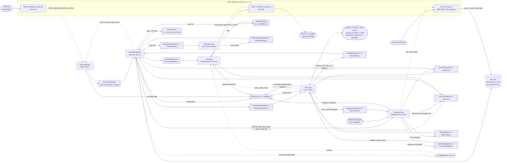

# RTOS architecture — Sound-Modulating Toy firmware

STM32F411RET6 (Nucleo-F411RE), FreeRTOS 10.x via CMSIS-RTOS v2 (`cmsis_os2.h`),
CubeMX 6.17.0 / FW_F4 V1.28.3, CMake + Ninja + arm-none-eabi-gcc 14.3.

Application code uses **only the CMSIS-RTOS v2 API**. Every shared object and
message type lives in `Core/Inc/app_rtos.h` and is created in
`Core/Src/app_rtos.c::App_RTOS_Init()` (called from `main()` between
`osKernelInitialize()` and the generated `osThreadNew()` calls). Task
priorities and stacks are fixed in CubeMX (`.ioc` → `main.c`) and are never
changed in code.

Modelled on ZEIT4230 lecture 07 slide 36 — legend: **solid = data flow**,
**dashed = event (flag / semaphore)**.

---

## 1. System diagram



---

## 2. Task table

| Task | Owner | Priority | Stack (words) | Owns (only this task calls HAL on it) | Blocks on | Produces | Period / deadline |
|---|---|---|---|---|---|---|---|
| `JackAudioTask` (`JackAudio_TaskEntry`, `jack_audio_sd.c`) | Jack | High | 768 | I2S2 RX + DMA1 S3 (`HAL_I2S_Receive_DMA/DMAStop`) | `osThreadFlagsWait(HALF\|FULL\|CMD, osWaitForever)` | `PcmFrame_t` → `pcmFrameQueue` (timeout 0); `FaultMsg_t` `FAULT_AUDIO_MIC_START` once per recording if the microphone DMA will not start (a volatile flag tells JackStorageTask, which then ends that recording at once) | 1 ms per PDM half; HALF+FULL together = `s_deadline_missed++` (slide 9) |
| `TomTask` (`Tom_TaskEntry`, `tom_dac_output.c`, **PD6-Tom**) | Tom | AboveNormal | 1024 | I2S3 TX + DMA1 S5 (circular, started once, never stopped); the 2:3 rate adapter, the speaker crossover and `tune_player_t` (static `.bss`); a part-used 48 kHz block between two halves | `osThreadFlagsWait(HALF\|FULL\|CMD, osWaitForever)`; `osMessageQueueGet(audioBlockQueue, 0)`; `osSemaphoreAcquire(faultBeepSem, 0)` (only while no tune plays) | filled DMA halves: two 32 kHz blocks, each 2:3 upsampled, or three 48 kHz blocks straight through (effect files and 48 kHz PC files; Jack gives the rate with `TOM_CMD_SOURCE_PLAYBACK`) → Q15 gain → **crossover** (left = tweeter, above 1.6 kHz; right = subwoofer, below 1.6 kHz and above 10 Hz) → trim (skipped on a silent half the crossover bypassed); `osMemoryPoolFree`. No effect runs here any more: effects come as effect files from FxRenderTask, and `TOM_CMD_SET_EFFECT` is ignored. `FaultMsg_t` `FAULT_AUDIO_SPK_START` once if the I2S3 DMA will not start. **Tune engine** (`PD5b_Tom/Application/TunePlayer/tune_player.c`, host-tested): the startup arpeggio once at task start, one fault beep per `faultBeepSem` count and `TOM_CMD_PLAY_TUNE` replace the source while they play (fixed 16384 = 50 % amplitude, 5 ms fade per note, not scaled by volume/mute). **Battery lockout** (`TOM_CMD_BATTERY_LOCKOUT` from Brendon): the critical tune, then playback gain 0 and silent test patterns until released; only warning tunes (priority ≥ 1) sound meanwhile; volume/mute are still stored | 4 ms per half = 288 000 cycles at 72 MHz; Tom's files are built at `-O2`, so a half with sound takes about 25-38 k cycles (9-13 %) and a silent half about 1 k; HALF+FULL together = `s_deadline_missed++`; no block = silence + `s_underruns++` |
| `BrendonTask` (`Brendon_TaskEntry`, `brendon_battery_usb.c`, **PD6-Brendon**) | Brendon | BelowNormal | 768 | I2C1 through `brendon_ports.c` (`bq_bus.h`: `HAL_I2C_Mem_Read_IT/Write_IT` + `BRENDON_I2C_DONE/ERR_FLAG` once CubeMX enables the I2C1 EV/ER IRQs, blocking owner-only fallback until then) + charger GPIOs PA0/PB8/PB4/PA9 (polled 100 ms) + USB device state (`hUsbDeviceFS`) + `MSC_Poll` while in MSC mode | `osDelay(LOOP_PERIOD_MS)` = 100 ms once per loop pass (the loop's pace); `osThreadFlagsWait(BRENDON_I2C_*, 100 ms)` per transfer; `osMessageQueueGet(brendonCmdQueue, 0)` (all pending, every loop pass, before `BatMon_Tick`: debug SOC override → `BatMon_SetSocOverride()`) | `BatteryMsg_t` (newest wins, 1 Hz from `BatMon_Tick`, incl. the speaker-lockout latch, the charger's charging flag, the gauge's instant current, our 2-minute average of it and our own time to empty / to full from a held copy of that average (it follows only a 5 % / 10 mA change), in the steps the screens show (`battery_time.c`, once per publish; the gauge's own slow estimate is now only on the debug screen)); `JackCmd_t` (`ENTER_MSC` / `EXIT_MSC`); `TomCmd_t`; `faultBeepSem` on a rising edge of the LOW alarm; `TOM_CMD_BATTERY_LOCKOUT` 1/0 when the lockout latch changes (the current state repeated every 10 publishes); `TOM_CMD_PLAY_TUNE(TOM_TUNE_CRITICAL)` when the critical alarm sets again while the lockout is still on from an earlier entry; `FaultMsg_t` on `faultQueue` (timeout 0, once per occurrence): lockout rising edge, gauge not found at task start, 3 invalid polls in a row, USB host gone after writing without ejecting; `PowerDebugMsg_t` on `powerDebugQueue` (newest wins, every 1 s, gauge present or not: the debug screen's Battery / power page) | 1 Hz gauge tick (5 core reads, then the instant current `Current()` and the gauge's time to empty / to full, these three only after 5 good core reads: one gauge read per second more than before best-ui; an extra poll at once when a debug SOC override is set, cleared or ends); 1 Hz power snapshot with one more gauge read, `Temperature()`, whenever the gauge was found (also after failed core reads, so a hung bus costs one more 100 ms timeout per second); charger 10 Hz; USB watch ≥ 10 Hz, 500 ms debounce; 2 s ENTER_MSC ack wait; a later ack with the same number is still taken |
| `JackStorageTask` (`JackStorage_TaskEntry`, `jack_audio_sd.c`, **PD6-Jack**) | Jack | Normal | 1024 | SDIO + FATFS through `jack_ports.c` (`storage_port.h`, `_FS_REENTRANT 0`) + SD_DETECT poll; every file and folder on the card, the effect files in `FX/` included; the `fxChunkPool` block while he holds it | `osMessageQueueGet(jackCmdQueue, …)`: 0 ms while recording, 2 ms while playing, otherwise 0 ms while a list or effect-file step can act, 2 ms after a pass that moved nothing (loop guard) and 100 ms when there is nothing to do; while a chunk is out, a 2-tick block on `fxRenderReplyQueue` first (never 0, so FxRenderTask always gets the CPU); `fxRenderReplyQueue` up to 50 ms when a park waits for the job's chunk (`jack_fx_park`, which lifts FxRenderTask to Low + 1 for that wait only); `pcmFrameQueue` (5 ms) while recording | `RECnn.WAV` via `recording_session` + `wav_build_header` (32 KB chunks, `STORAGE_SLOW` > 150 ms, 3 x slow = safe stop); `AudioBlock_t*` → `audioBlockQueue` (timeout 20) via `playback_session` + `wav_parse_header`, 32 or 48 kHz; effect files `FX/<EFFECT>/RECnn.WAV`, one bounded `fx_job` step per loop pass and only while nothing plays or records (`FxRenderReq_t` → `fxRenderReqQueue`, timeout 0, one chunk out at most); PLAY, REC, DELETE, an effect switch and a quiet remount first **park** the job (`jack_fx_park`: wait for its chunk, write what is staged, close both files, keep its resume point in a 6-row RAM park table) and it carries on later (exactly, or rebuilt with a short pre-roll and the job's carry); only DELETE of its own recording, REC99 over it, USB, a pulled card and a mount abort it for good; `TomCmd_t`; `StorageStatusMsg_t` (newest wins, from `storage_status_get_ui_view`, also whenever an effect-file field changes); `StorageReply_t` (a window of 16 names out of every WAV) / `JackReply_t` (with the command's `seq`) on reply queues; `faultBeepSem`; `FaultMsg_t` on `faultQueue` (timeout 0, one per failed operation: card pulled while recording, playing, paused or preparing, write fail / full / 3 x slow, record start refused, mount failed (once per insertion), WAV rejected, read fault, a full card, a card error or a refusal while making the effect file the user waits for) | pcmFrameQueue must be drained within 200 ms (queue depth); playback pool topped up every 2 ms (16 blocks = 32 ms at 32 kHz, 21.3 ms at 48 kHz) |
| `TonyTask` (`Tony_TaskEntry`, `tony_ui.c`, **PD6-Tony**) | Tony | Low | 768 | SPI1 (TFT) and ADC1 (touch) through `tony_ports.c` (`_IT` + `TONY_SPI/ADC_DONE_FLAG` once CubeMX enables the SPI1 / ADC IRQs, blocking owner-only fallback until then), input GPIOs | `osDelay(10)` (slide 13 ButtonTask shape); `batteryQueue` / `storageStatusQueue` / `faultQueue` (all pending) / `powerDebugQueue` / private `StorageReply_t` queue (timeout 0); `osThreadFlagsWait(TONY_*_DONE_FLAG)` per transfer | `FaultMsg_t` → `ui_show_fault()` → modal **fault screen** (drawn right after the drain, before the input scan; any input closes it and is consumed; input is ignored for 0.3 s after it is drawn and again after the screen under it is back; a `FAULT_AUDIO_FX_BUDGET` is ignored: nothing sends it any more); inputs → `ui_event_t` (`scan_inputs()`: the knob counted by TIM3 in encoder mode, `touch_calibration` + `touch_region`, debounced buttons; `encoder_sm` is compiled but only the host tests use it) → `ui_process_event()` → **diff of `ui_state_t`** → `JackCmd_t` (each with a `seq`; the effect and the selected file go to Jack), `TomCmd_t` + `TOM_CMD_FLAG`, `StorageReq_t` (Appendix C); `ui_get_display_info()` rendered; the File screen holds a window of 16 names (`file_window.c`) and asks Jack for the next one while you scroll; the Delete row with its tap-again confirm (`delete_confirm.c`; the answer comes in Jack's status); `Preparing nn%` and `n/a` (only the changed characters are redrawn); the frog screen saver after 30 s without input (`screen_saver.c`; the first input only wakes the screen); `BatteryMsg_t.lockout` → `ui_state_t.speaker_locked` (red `BAT nn% MUTED` status line, Volume-screen notice; it only changes the drawing, Tom does the muting); `BatteryMsg_t` `soc_pct` / `current_now_mA` / `current_avg_mA` / `voltage_mV` / `tte_min` / `ttf_min` / `charging` / `valid` → the Battery screen's six lines (charge, current now, 2-minute average current, voltage, time, status incl. `Plugged in` / `Full`; only lines whose text changed are redrawn; the gauge's slow `current_mA` and its own times reach only the debug screen, through `PowerDebugMsg_t`). **Hidden debug screen** (`tony_debug.c`, BACK held 2 s on Home, section 6): keeps the newest `PowerDebugMsg_t` (Battery / power page), `STORAGE_REQ_STATUS` once a second on the Storage page while `storageReqQueue` is empty (the reply's bus width / last result / capacity → `s_sto`), `App_RTOS_GetStats()` on the System page; Speaker page → `TomCmd_t` `TEST_PATTERN` / `PLAY_TUNE` / `STOP` (+ `SOURCE_PLAYBACK` when Jack is playing); Faults page → `BrendonCmd_t` SOC override on `brendonCmdQueue` (put 10 ms, drop counted `brendon_cmd`) or a simulated `FaultMsg_t` (`App_RTOS_RaiseFault`, comes back to Tony's own fault screen) | 10 ms scan, touch sampled every 40 ms; render only when dirty; Jack's status reconciles the transport state at once when it carries Tony's newest `seq`, else after 1 s without a UI command; fault screen on the panel ≤ 500 ms after the dequeue (IR6; estimate ~0.3 s); debug pages refreshed once a second (changed rows only, ~20 ms per row), a full page ≈ 0.4 s (on opening, page change, after a fault overlay; a fault arriving meanwhile stops it before the next row) |
| `FxRenderTask` (`TomFx_TaskEntry`, `tom_fx_render.c`; created by `App_RTOS_Init`, not CubeMX) | Tom | Idle (FreeRTOS 1), on purpose: `cmsis_os2.h:84` reserves `osPriorityIdle` for the idle thread, but this FreeRTOS wrapper maps it to 1, above the kernel's idle task at 0 (under another CMSIS kernel it would share the idle level). Only while a park waits for its chunk (at most 50 ms) Jack lifts it to Low + 1, above TonyTask's redraw, then puts it back | 512 (static) | the effect DSP state (`FxRender`, the only `AudioEffectsState`, about 23 KB static); no peripheral | `osMessageQueueGet(fxRenderReqQueue, osWaitForever)` | for each `FxRenderReq_t`: `FxRender_Begin` on a job's first chunk, `FxRender_LoadCarry(chunk->carry)` on a `FX_REQ_RESTORE` chunk (a rebuilt file carries on there), then `FxRender_Process` (the old live chain: 2:3 upsampler for a 32 kHz source, then the effect) from `in[]` to `out[]`, then `FxRender_SaveCarry` into `chunk->carry`; `FxRenderReply_t` → `fxRenderReplyQueue` (timeout 0) | none: it only gets the CPU time every other task leaves (about 90 % while nothing plays); at `-O2` a 10 s recording's Echo file takes about 1.3 s, Autotune about 11 s, all six about 20 s |

Generated helper threads: FreeRTOS idle (static, 128 w, priority 0) and
timer service (static, 256 w, priority 2; no software timer is used).
While an effect file is being made, FxRenderTask (priority 1) leaves the
idle task almost no CPU time: the idle task runs only in short gaps, for
example while Jack waits for the card and no chunk is being worked on.
That is safe here, because nothing needs the idle task: its jobs are
freeing the memory of deleted tasks (no task is ever deleted), the idle
hook (`configUSE_IDLE_HOOK` 0) and low-power tickless sleep (off), and
there is no watchdog to feed.

Boot order: `main()` runs every `X_Init()` **before** `osKernelInitialize()`
(hardware + module state only, no RTOS object), then `App_RTOS_Init()` (which
also starts FxRenderTask), then the five generated `osThreadNew()`, then
`osKernelStart()`. Anything that needs a queue
or flag happens at the top of the corresponding `X_TaskEntry()`. The USB
stack is not started at boot: `MX_USB_DEVICE_Init` has "Do Not Generate
Function Call" ticked in the .ioc, and BrendonTask's `usb_gate` starts it only
while VBUS_SENSE (PA9) is high and stops it (`USBD_DeInit`) when VBUS drops or
the host leaves (AN4879 §2.6.1/§3.1.1: a self-powered device must not pull up
D+ without VBUS).

---

## 3. Message catalogue (`Core/Inc/app_rtos.h`)

| Object | Type / element | Length | Producer → consumer | Put timeout | Drop / full policy (slide 18) |
|---|---|---|---|---|---|
| `jackCmdQueue` | `JackCmd_t {type, effect, index, seconds, name[13], seq, replyQueue}` (24 B) — `RECORD_START/STOP, PLAY_START/PAUSE/RESUME/STOP, ENTER_MSC, EXIT_MSC, SET_EFFECT, DELETE`. `PLAY_START` names the file (the raw 8.3 name; `index` only when the name is empty) and the effect; `SET_EFFECT` carries the selected effect and file; `DELETE` the file to delete with its effect files | 8 | Tony, Brendon → JackStorageTask | 10 ms (tasks) | count `g_rtos_dropped.jack_cmd`; optional `JackReply_t{type, ok, detail, seq}` on `replyQueue`; `SET_EFFECT` and `DELETE` have no ack (their answer is in the status) |
| `storageReqQueue` | `StorageReq_t {type, index, anchor[13], replyQueue}` (24 B) — `LIST_FILES` (the user's retry: unless Jack is recording or playing or the card is on a PC, it also clears a card fault and rescans, and Jack publishes his status before the answer), `FILE_NAMES`, `STATUS` | 4 | Tony (File / Play screens: a window of names; the debug Storage page's `STATUS` once a second, sent only while this queue is empty, so at most one is outstanding) → JackStorageTask | 10 ms | reply `StorageReply_t {type, storage_result, count, first, total, found, list_gen, names[16][13], status}` (292 B) put on the requester's own queue with timeout 0 (slide 24): up to 16 names around `index`, or around the file named `anchor` (its place comes back in `found`), out of every WAV in the card root; `total` counts them all. From a `STATUS` reply Tony takes only `bus_width`, `last_result`, `total_kb`, `free_kb`: Jack answers before the rest of his loop pass, so a `storageStatusQueue` publish can be newer, and the card / transport / status-text fields stay newest-wins |
| `tomCmdQueue` (+ `TOM_CMD_FLAG`) | `TomCmd_t {type, value}` — `SET_EFFECT` (obsolete: ignored), `SET_VOLUME(0..100), SET_MUTE, SOURCE_PLAYBACK(TomSourceRate_t: 1 = 32 kHz, 2 = 48 kHz, 0 = keep), SOURCE_TEST, TEST_PATTERN(Tom_Test_t), STOP, PLAY_TUNE(TomTune_t), BATTERY_LOCKOUT(1 engage / 0 release)` | 8 | Tony, Brendon, JackStorageTask → TomTask | 10 ms | count `tom_cmd`; Tom drains the queue whenever `TOM_CMD_FLAG` is set. `STOP` stops the source, not a playing tune. At every start, resume and effect switch Jack sends `STOP`, queues the first blocks, then `SOURCE_PLAYBACK(rate)`; a rate change, `STOP`, `SOURCE_TEST` and `TEST_PATTERN` free a held 48 kHz block. `PLAY_TUNE` while a tune plays is queued once (one slot: a request of at least the queued tune's priority replaces it; the same tune again or a lower priority is ignored); an unknown id is ignored. `BATTERY_LOCKOUT 1` (Brendon only) cuts a non-warning tune, plays `TOM_TUNE_CRITICAL`, then holds the gain at 0; `0` restores the stored volume/mute; a value equal to the current state is ignored (Brendon repeats the current state every 10 s, so one dropped put can neither leave the speaker on nor keep it muted after the release). Because a repeated `1` is ignored, Brendon sends `PLAY_TUNE(TOM_TUNE_CRITICAL)` instead when the critical alarm sets again while the lockout is still on from an earlier entry. While locked, a `PLAY_TUNE` of a priority-0 tune is refused |
| `batteryQueue` | `BatteryMsg_t {voltage_mV, current_mA, soc_pct, valid, low, critical, lockout, charging, tte_min, ttf_min, current_now_mA, current_avg_mA}` (18 B) — `lockout` = the speaker-lockout latch (`BatMon_IsSpeakerLockout`: sets with critical < 10 %, clears at ≥ 32 %), **not** gated by `valid`; `charging` = the charger's STAT pin says charging (`Charger_GetState() == CHARGER_STATE_CHARGING`; only while that state is still UNKNOWN: `valid && current_mA > 0`); `current_mA` = the gauge's AverageCurrent (a slow filter); `current_now_mA` = the gauge's `Current()`, the last second (AverageCurrent if that read failed), 0 when not valid; `current_avg_mA` = our average of the last 120 readings, 2 minutes (`battery_time.c`; 10 until 1 Nov), restarted when the charging flag changes or after 120 invalid readings in a row (a shorter gap keeps it), the 2 readings after a charger change left out (shown as they are meanwhile) and so is a reading where AverageCurrent stood in, 0 when not valid; `tte_min` / `ttf_min` = our estimate in minutes, from a held current that takes the average only when it is 5 % (at least 10 mA) away: time to empty RemainingCapacity × 60 / −held while draining (from avg ≤ −10 mA until avg ≥ 0), also while charging (loud music can take more than the charger gives); charging → time to full (FullChargeCapacity − RemainingCapacity) × 60 / held while filling (from avg ≥ +10 mA until avg ≤ 0), 0 when RemainingCapacity ≥ FullChargeCapacity; not charging → time to full 0 when the charger reports the charge complete; rounded to the minute, capped at 5999 (99:59), then sent as the screens show them: in steps of 1 min under an hour, 5 min under 10 h, 15 min from 10 h, moving one step once the time is 1.5 steps away (straight there from 2.5 steps; 0 and unknown at once); **65535 = no estimate** (shown `--:--`: fewer than 3 readings averaged, neither draining nor filling, no FullChargeCapacity, an invalid reading). The gauge's own AverageTimeToEmpty / AverageTimeToFull are only in `PowerDebugMsg_t` (debug screen) | 1 | BrendonTask (1 Hz) → TonyTask | 0 after `osMessageQueueReset` | newest wins |
| `storageStatusQueue` | `StorageStatusMsg_t {card_present, mounted, record_enabled, play_enabled, percent_used, msc_mode, recording, playing, file_count, list_gen, status_text[16], current_name[13], bus_width, last_result, play_effect, prep_pct, fx_busy, fx_job_effect, fx_job_pct, fx_job_name[13], cmd_seq, cmd_ok, cmd_detail, total_kb, free_kb}` (72 B) — `playing` 0 idle, 1 playing, 2 paused, 3 preparing (the effect file PLAY waits for is made first; `prep_pct` 0..100 in 5 % steps); `file_count` = every playable WAV (`uint16_t`); `list_gen` +1 whenever the list may have changed; `play_effect` = the effect heard; `fx_busy` = effect files are being made (the `SD BUSY` chip); `fx_job_*` = the file being made now (debug Storage page); `cmd_seq` / `cmd_ok` / `cmd_detail` = Tony's last command that Jack has handled and its result (DELETE's only answer). For the debug screen's Storage page: `bus_width` = 4 or 1 while the FatFs volume is mounted (`SD_Bus4BitStatus()`: 1 → 4-bit, 2 → 1-bit), else 0 — also during a runtime fault (Card too slow / write fail / full / read fault), when `mounted` is 0 but the volume and its bus width are unchanged and a 1-bit fallback is the likely clue; `total_kb` / `free_kb` = `f_getfree` at mount and after every recording, delete and effect file (0 = unknown); `last_result` = `storage_result_t` of the most recent failed operation, 0 = none since the last good mount (see "Debug screen" below) | 1 | JackStorageTask → TonyTask (the same struct is in every `StorageReply_t`) | 0 after reset | newest wins; Jack also publishes when an effect-file field changes, and after the File screen's `LIST_FILES` rescan (before its answer) |
| `pcmFrameQueue` | `PcmFrame_t {int16_t pcm[32]}` = 64 B (**static storage, 12.8 KB**) | 200 | JackAudioTask → JackStorageTask | 0 | count `pcm_frame`; ≥ 200 ms of SD stall absorbed |
| `audioBlockPool` | `AudioBlock_t {int16_t pcm[64], count, seq}` (**static storage, 2.1 KB**): 32 or 48 kHz samples, so 16 blocks hold 32 ms or 21.3 ms of sound | 16 blocks | JackStorageTask `osMemoryPoolAlloc(…, 0)` → TomTask `osMemoryPoolFree` | — | producer allocs + fills + puts and no longer owns it; consumer gets + processes + frees (slide 31); pool empty → producer retries after 2 ms; TomTask may keep one part-used 48 kHz block between two halves and frees it once used up, on a rate change or on `STOP` |
| `audioBlockQueue` | `AudioBlock_t *` | 16 (= pool) | JackStorageTask → TomTask | 20 ms | count `audio_block`; a refused put frees the block back to the pool; `TOM_CMD_STOP` makes Tom drain + free everything queued |
| `faultBeepSem` | counting semaphore | max 4, initial 0 | BrendonTask (rising LOW edge only: the critical edge plays `TOM_TUNE_CRITICAL` instead — through `TOM_CMD_BATTERY_LOCKOUT 1` on the first entry, or `TOM_CMD_PLAY_TUNE(TOM_TUNE_CRITICAL)` when the lockout is still on from an earlier entry — and a first reading already below 10 % gives the critical tune only, no beep), JackStorageTask (write fail; card pulled while recording, playing, paused or preparing; playback read or loop-seek fault; a full card, a card error or a file-system refusal while making the effect file PLAY waits for (`storage_prepare_fault`); a card error while an effect file is checked before it plays (`play_refused`)) → TomTask | `osSemaphoreRelease` | backlog full → release refused, Tom is already beeping (slide 12); Tom takes one count only while no tune plays and plays `TOM_TUNE_FAULT` through the tune engine (1 kHz 200 ms, 50 % amplitude, 5 ms fades) instead of the source, so a backlog plays beep after beep and a beep never cuts the startup tune short |
| `faultQueue` | `FaultMsg_t {source, code, line2[21], line3[21]}` (44 B) — `FaultSource_t` (`STORAGE, BATTERY, USB, AUDIO, SYSTEM`), `FaultCode_t` (table below), `FAULT_CODE_SIMULATED` 0x80 OR'ed in by the debug screen's fault injection | 4 | JackStorageTask, BrendonTask, JackAudioTask and TomTask (a DMA that will not start), TonyTask (the debug screen's simulated `Storage fault`, `FAULT_SD_REMOVED \| FAULT_CODE_SIMULATED`, which comes back to its own fault screen) → TonyTask | 0 (`App_RTOS_RaiseFault()`, task context only; text cut to 20 characters) | count `fault`. Producers send **once per occurrence** (rising edge / failed operation, never per poll), which is what makes the screen edge-triggered. Tony drains all pending every loop: `FAULT_AUDIO_FX_BUDGET` is no longer produced (ignored); everything else → `ui_show_fault()` (same source + code while shown = no change; a different fault replaces the text and keeps the return screen) |
| `brendonCmdQueue` | `BrendonCmd_t {type, soc_pct, seconds}` (4 B) — `BRENDON_CMD_SOC_OVERRIDE`: use `soc_pct` (0..100) instead of the gauge's SOC for `seconds`; 0 s = clear | 4 | TonyTask (debug screen, Faults page) → BrendonTask | 10 ms | count `brendon_cmd`. Brendon drains all pending with timeout 0 every loop pass (100 ms), before `BatMon_Tick`; debug page 5 shows the result (`sent`, the override's seconds left, or `overrides refused` without a gauge) |
| `powerDebugQueue` | `PowerDebugMsg_t {voltage_mV, current_mA, soc_pct, soc_override, override_left_s, tte_min, ttf_min, temp_dC, gauge_present, valid, charger_state, power_good, vbus, usb_running, usb_state, msc_active, low, critical, lockout, i2c_irq}` (26 B) | 1 | BrendonTask (every 1 s, gauge present or not) → TonyTask (debug screen, Battery / power page) | 0 after `osMessageQueueReset` | newest wins; count `power_debug` |
| `fxRenderReqQueue` (static) | `FxRenderReq_t {chunk, job, n_in, effect, src_48k, flags}` (12 B): one chunk of a recording to turn into its effect file; `FX_REQ_FIRST` starts a file (`FxRender_Begin`), `FX_REQ_LAST` ends it, `FX_REQ_RESTORE` = a rebuilt file carries on here (load `chunk->carry` first; one that is none or another effect's is answered `FX_STATUS_BAD_REQUEST`) | 2 | JackStorageTask → FxRenderTask | 0 | at most one request is out, so the queue is never full; a refused put would count `fx_render` |
| `fxRenderReplyQueue` (static) | `FxRenderReply_t {chunk, job, n_out, status}` (12 B): the same chunk back with `out[]` filled and `carry` = the effect's carry after this chunk (Jack keeps the latest with the job); `status` 0 = good, 1..0x7F = that part went through dry, `FX_STATUS_BAD_REQUEST` = the job must stop | 2 | FxRenderTask → JackStorageTask | 0 | at most one reply is out; the reply of an aborted job, or of a chunk a park gave up (an old `job` number), is freed unread; a refused put counts `fx_render` (never expected) |
| `fxChunkPool` (static) | `FxChunk_t {int16_t in[512], out[768]; uint8_t carry[44]}` (2 604 B) | 1 block | JackStorageTask `osMemoryPoolAlloc(…, 0)` → FxRenderTask → JackStorageTask `osMemoryPoolFree` | — | the pointer travels inside the two messages and whoever holds it owns the block (slide 31); Jack frees it after writing `out[]` to the card; no block home = a refused send, Jack tries again 2 ms later |
| Thread flags | `JACK_AUDIO_HALF/FULL/CMD_FLAG`, `TOM_DAC_HALF/FULL_FLAG`, `TOM_CMD_FLAG` | — | ISRs / tasks → owner task | — | slide 9 deadline check: HALF and FULL pending together |
| `g_msc_media_ready` | `volatile uint8_t` | — | JackStorageTask → `usbd_storage_if.c` (OTG_FS ISR) | — | `STORAGE_IsReady/Read/Write_FS` report "no medium" while 0 |

Private reply queues (created by the task that waits on them, slide 24):
`BrendonTask` has a 1-deep `JackReply_t` queue (ENTER_MSC ack); `TonyTask`
has a 1-deep `JackReply_t`
queue (RECORD_START / PLAY_START acks) and a **2-deep** `StorageReply_t`
queue. The File / Play screens' file lists and the debug Storage page's
`STATUS` replies share it and Jack replies with timeout 0, so the second slot
keeps a `STATUS` reply still on its way from making Jack drop a file list
(292 B more RTOS heap than one slot).

Every command carries a number, `seq`, and every ack carries the number of
the command it answers, so an older ack is told apart (BrendonTask numbers
its ENTER_MSC and still takes a late ack with that number). `SET_EFFECT` and
`DELETE` have no ack: Jack's status says how Tony's last command ended
(`cmd_seq` = its `seq`, `cmd_ok`, `cmd_detail`). A status that carries
Tony's newest `seq` shows Jack after that command, so Tony trusts it at once.

`UiEffect_t` (`UI_EFFECT_NONE, UI_EFFECT_1..6`) mirrors
`PD5b_Tony/Application/ui_types.h::ui_effect_t` so Tony, Jack and Tom agree
without including each other's headers. FxRenderTask maps it to
`AudioEffectMode` (1 → AUTOTUNE, 2 → PITCH_UP, 3 → PITCH_DOWN, 4 → ROBOT,
5 → ECHO, 6 → REVERB; NONE = the original file), and Jack to the folders
`FX/AUTOTUNE`, `FX/PITCHUP`, `FX/PITCHDN`, `FX/ROBOT`, `FX/ECHO` and
`FX/REVERB` (`fx_store.c`): Echo of `REC05.WAV` is `FX/ECHO/REC05.WAV`.

`TomTune_t` (`TOM_TUNE_STARTUP, TOM_TUNE_CRITICAL, TOM_TUNE_FAULT`) is the
`TOM_CMD_PLAY_TUNE` value; Tom maps it to the `const` note tables in
`PD5b_Tom/Application/TunePlayer/tune_player.c` (startup C5-E5-G5-C6
620 ms, critical G5-E5-C5 with 20 ms rests 520 ms, fault 1 kHz 200 ms).
Each tune has a priority (0 startup, 1 fault, 2 critical; ≥ 1 = a warning)
that decides whether it may replace the one queued tune.

Critical-battery speaker lockout (PD2 2.20): the latch lives in
`PD5b_Brendon/Application/battery_monitor.c` (host-tested) and travels two
ways — `BatteryMsg_t.lockout` to TonyTask (display only) and
`TOM_CMD_BATTERY_LOCKOUT` to TomTask (the actual muting: gain 0, tunes of
priority ≥ 1 still play). No new queue: `BatteryMsg_t` grows from 8 to 10
bytes (the queue is 1 deep, so the RTOS heap cost is a few bytes; the
≈ 3.5–4 KB heap headroom is unchanged). Behaviour and board test: section 6.

Time to empty / to full (PD2 B9): `BatMon_Tick` reads AverageTimeToEmpty
(0x18) and AverageTimeToFull (0x1A) after the five core reads of every 1 Hz
poll, only when all five succeeded (a gauge that is not answering would cost
two more bus timeouts). A failed time read leaves 65535 for that value and
never invalidates the snapshot; an invalid snapshot carries 65535 for both.
**The gauge itself reports 65535 (shown `--:--`) until it has learned the
pack** — see the project doc `BQ34Z100_Calibration_Learning_Plan.md` for
the learning cycle — and also for time to empty while not discharging and
time to full while not charging. No new queue: `BatteryMsg_t` grows from 10
to 14 bytes (`charging` sits with the other flags, so no padding), +4 B of
RTOS heap; the ≈ 3.5–4 KB headroom is unchanged. Two more blocking I2C
reads per second on the fallback path (~0.5 ms each: about 48 bit times at
100 kHz) are well within BrendonTask's budget.

Fast time to empty / to full (best-ui, 29 Oct 2026): those gauge times
follow its slow AverageCurrent, so on the board, after the charger was
unplugged, TO FULL climbed to 99 h for minutes before TO EMPTY appeared.
`BatteryMsg_t.tte_min` / `ttf_min` are now our own estimate
(`PD5b_Brendon/Application/battery_time.c`, host-tested), worked out once
per publish from RemainingCapacity, FullChargeCapacity and an average of
the last 10 readings (120 since 1 Nov, see below) of the gauge's `Current()` (0x10, the last second,
read right after the five core reads; if that read fails, AverageCurrent
stands in on the screen but is left out of the average, since it can still
carry the old current for minutes). The average restarts when the
charging flag changes, so the old
time (TO FULL after an unplug) goes to `--:--` at the first publish that
sees the change and the new one shows four publishes later: the two
readings after the change are left out (`Current()` is the gauge's own 1 s
average, not in step with our poll, so they still carry the old current),
then three are averaged. The gauge's
own two times are now only on the debug screen (`PowerDebugMsg_t`).

Steadier times (1 Nov 2026): music makes `Current()` jump from second to
second (about 125 mA idle, 135-220 mA moderate, 300-400 mA loud), and the
10-reading average made the times jump by hours. The average is now the
last 120 readings (2 minutes); the times come from a held current that
only follows the average once it has moved 5 % (at least 10 mA), so a few
mA of wobble on a small net current on the charger does not move them by
hours; a time to empty is also given on the charger when the battery
drains; and the times are sent in steps of 1 / 5 / 15 min that move one
step once the new time is 1.5 steps away, or straight there from 2.5
steps (`battery_time.h` explains the four stages). The Battery screen shows
both: line 2 the current of the last second (`Current`, which moves with
the music) and line 3 the 2-minute average (`Average`), which the times
come from.
`BatteryMsg_t` grows from 14 to 18 bytes (`current_now_mA`,
`current_avg_mA`), +4 B of RTOS heap, and the poll makes one more gauge
read per second (~0.5 ms on the blocking fallback path).

Fault screen (PD2 IR6, 4.11–4.13): `faultQueue` takes ≈ 0.26 KB of the RTOS
heap (4 x 44 B + control block), leaving ≈ 3.2–3.7 KB. `ui_types.h` mirrors
`FaultSource_t`, `FAULT_TEXT_MAX` and `FAULT_CODE_SIMULATED`; `tony_ui.c`
checks the mirror with `_Static_assert`. Codes, text and producers:

| Code | Line 2 / line 3 on the TFT | Producer: when |
|---|---|---|
| `FAULT_SD_REMOVED` | SD card removed / Recording stopped *or* Cannot record *or* Playback stopped *or* Effect not made | Jack: SD_DETECT high while recording, or while playing or paused (`Playback stopped`), or while preparing (`Effect not made`); also a failed write (`Cannot record` at record start) or playback read (`Playback stopped`) with the slot already empty |
| `FAULT_SD_WRITE_SLOW` | Card too slow / Recording stopped | Jack: 3 slow writes in a row (CR1 safe stop) |
| `FAULT_SD_FULL` | Card full / Recording stopped *or* Cannot record *or* Effect not made | Jack: a write, or the header write at record start, found the card full; or no room for the effect file the user waits for |
| `FAULT_SD_WRITE_FAIL` | Card write failed / Recording stopped *or* Cannot record *or* Effect not made; also Effect not made / Check FX on a PC | Jack: write failed; file open or header write failed at record start; the effect file the user waits for could not be written (or the file system refused it) |
| `FAULT_SD_MOUNT` | Card error / Cannot read card *or* Format as FAT32 | Jack: card answers but the mount failed — once per insertion (re-armed by a removal or a good mount). `Format as FAT32` (no FAT filesystem) at once; `Cannot read card` only when a re-mount of the same card fails too (the automatic one ~2 s later, or a retry): a read failure on insertion is often contact bounce that the re-mount gets past |
| `FAULT_SD_FILE_REJECTED` | File rejected / Bad WAV header *or* Need mono 16-bit | Jack: play start refused the file |
| `FAULT_SD_READ_FAIL` | Card read failed / Playback stopped *or* Effect not made | Jack: read fault while playing, or the WAV header could not be read, or while making the effect file the user waits for |
| `FAULT_BAT_CRITICAL` | Critical charge / Speaker muted | Brendon: speaker-lockout rising edge (not on the 10 s repeats) |
| `FAULT_BAT_GAUGE_MISSING` | Gauge not found / Battery info off | Brendon: no gauge at task start (once per boot) |
| `FAULT_BAT_GAUGE_LOST` | Gauge not answering / Battery info off | Brendon: 3 invalid polls in a row from a gauge that was found; re-armed by a valid poll |
| `FAULT_USB_ABORTED` | Transfer aborted / Card re-mounted | Brendon: host gone while the card was handed over, after ≥ 1 successful host write, without a SCSI eject |
| `FAULT_AUDIO_FX_BUDGET` | - | No longer produced: effects are made ahead (Tony ignores it) |
| `FAULT_AUDIO_MIC_START` | Mic failed to start / Cannot record | JackAudioTask: the microphone DMA (I2S2) would not start; sent once per recording. JackStorageTask then ends that recording at once instead of staying on `Recording` |
| `FAULT_AUDIO_SPK_START` | Speaker DMA failed / No sound | TomTask: the speaker DMA (I2S3) would not start at task start; sent once |

USB "dirty card" signal: FatFs cannot see the FAT32 dirty bit, so "wrote but
never ejected" stands in for it. `STORAGE_Write_FS` (USER CODE block,
OTG_FS ISR) only increments `g_msc_host_writes` (`brendon_ports.h`);
BrendonTask zeroes it before each hand-over and copies the eject state
(`scsi_medium_state == SCSI_MEDIUM_EJECTED` in the MSC class data) on every
loop pass, because `pClassData` is released when the USB stack stops. A host
that is unplugged or sleeps without sending SCSI START STOP UNIT (eject) after
writing counts as aborted. Not detected on purpose: an ILI9341 init failure
(the panel gives no feedback over SPI).

Debug screen (PD2 development/debug state): TonyTask's debug pages get all
their data through messages, so TonyTask still never touches I2C1, the
charger pins, the USB stack or the SD card. `brendonCmdQueue` and
`powerDebugQueue` take ≈ 0.2 KB of the RTOS heap with their control blocks,
and `StorageStatusMsg_t` grew from 38 to 48 B (`storageStatusQueue` grows by
10 B; `StorageReply_t` from 249 to 260 B, +11 B with the alignment pad the
embedded status now needs, so every reply-queue slot grows by 11 B, and so
does every `StorageReply_t` on a task stack). TonyTask's `StorageReply_t`
queue also gets a second slot (+260 B, see *Private reply queues* above):
≈ 0.5 KB in all, leaving ≈ 2.7–3.2 KB (not measured yet: read heap free /
min ever on the debug screen's System page).

- **SOC override** (the Faults page's `Battery LOW 25%` / `CRIT 8%` / `OK 60%`
  / `Clear overrides`): `BatMon_SetSocOverride()` in
  `PD5b_Brendon/Application/battery_monitor.c` (host-tested) uses the given
  SOC instead of the gauge's for N seconds — in the plausibility check, the
  snapshot and the low / critical / lockout latches. Voltage, current and the
  time estimates stay the gauge's, and a failed gauge read still makes the
  poll invalid. Setting or clearing it makes the next `BatMon_Tick` poll at
  once, so the new SOC is on `batteryQueue` in the same BrendonTask loop pass;
  the tick ends it wrap-safely (`(int32_t)(now - until) >= 0`) and polls at
  once again, so the real SOC is back straight away. Refused, with nothing
  stored, without a gauge (`BATMON_NO_GAUGE`) or above 100 %
  (`BATMON_BAD_PARAM`). Everything after it is the real code: the LOW beep,
  the critical tune and speaker lockout, the "Critical charge" fault screen,
  the status bar. Clearing the override or letting it run out does **not**
  reset the latches: they go on from the injected SOC to the real one with
  their usual hysteresis. After `Battery CRIT 8%` the speaker therefore stays
  locked (status bar `BAT nn% MUTED`) until a valid SOC of at least 32 % — so
  always finish a battery test with `Battery OK 60%`, which releases it; once
  that has ended, a real SOC of 10 % or more does not lock it again.
- **Power snapshot** (`PowerDebugMsg_t`): BrendonTask's own state — the last
  snapshot and latches, the override and its seconds left (rounded up),
  `Charger_GetState()` / PG / VBUS, `s_usb_running`, `hUsbDeviceFS.dev_state`
  (`USBD_STATE_*`: 1 default, 2 addressed, 3 configured, 4 suspended; 0 before
  the stack has ever started), `s_msc_active` and the I2C mode. The only extra
  gauge traffic is one `Temperature()` read per publish while the gauge is
  present (tried even after failed core reads, so a hung bus costs one more
  100 ms timeout per second): 0.1 K → `temp_dC` = reading − 2732 (0.1 °C),
  `INT16_MIN` when the gauge is absent or the read fails.
- **`last_result`** (`StorageStatusMsg_t`) is set by a mount that failed on a
  card that answers (an empty slot is not a failure), by every runtime fault
  that reaches the card state machine (write fail / full / 3 × slow, playback
  read fault, unreadable directory, record start refused), by a file that
  could not be opened for playback and by a WAV rejected at play start
  (`STORAGE_READ_FAIL` when its header could not be read, otherwise
  `STORAGE_CORRUPT`, also for "not mono 16-bit"). A good mount clears it.
- **System page:** `App_RTOS_GetStats(AppRtosStats_t *)` fills in uptime, heap
  free / min ever / total, a copy of `g_rtos_dropped`, `jackMissed`,
  `tomMissed`, `underruns` and every task's high-water free stack in bytes
  (`APP_RTOS_STACK_UNKNOWN` = task not created), in `App_RTOS_TaskName()`
  order: JackAudio, Tom, JackStorage, Brendon, Tony, FxRender. It only reads
  RTOS objects and counters, so any task may call it.
  `App_RTOS_BuildString()` is `__DATE__ " " __TIME__` of `app_rtos.c`. The
  root `CMakeLists.txt` makes that file depend on every other source and
  header in `Core/`, the `PD5b_*` modules, `USB_DEVICE/` and `FATFS/`
  (`OBJECT_DEPENDS`, from a `CONFIGURE_DEPENDS` glob), so an incremental build
  that changes any of them recompiles it and the stamp stays the image's build
  time. Nothing else is watched (`Drivers/`, `Middlewares/`, the linker
  script): after a change only there, a clean build moves the stamp.

---

## 4. RAM budget

STM32F411RET6: 128 KB SRAM, 512 KB flash. Linker `_Min_Stack_Size` 1 KB (MSP:
used before `osKernelStart()` and by ISRs), `_Min_Heap_Size` 512 B (newlib).

### 4.1 Phase 0.3 (buffer resize)

| Item | Before (9 Sep 2026) | After 0.3 | Note |
|---|---|---|---|
| `s_tx_buffer` (Tom, I2S3 DMA) | 96 000 B (24000 frames = 500 ms, mis-commented "100 ms") | 1 536 B (2 x 192 frames = 8 ms) | double buffer, see `tom_dac_output.h` |
| `s_pdm_queue` (Jack, ISR ring) | 49 152 B (192 x 256 B) | 8 192 B (transitional) → **deleted in 1.4** | replaced by `pcmFrameQueue` |
| `s_sd_buf` (Jack, SD staging) | 32 768 B | 32 768 B | kept (also the playback read-ahead buffer) |
| `ucHeap` (`configTOTAL_HEAP_SIZE`) | 28 672 B | 28 672 B | six task stacks = 4736 words = 18.9 KB + TCBs + control queues |
| **Link result** | **RAM overflowed by 88 256 B** | 83 912 B used (64 %) | |

### 4.2 After Phase 1 (`cmake --preset Debug`, clean build, 0 warnings)

```
   text    data     bss     dec
 156196     536   90360  247092   Sound_modulation_group_demonstration_project.elf
```

| Region | Bytes | Of which |
|---|---|---|
| `.data` | 536 | |
| `.bss` | 90 360 | `s_sd_buf` 32 768 · `ucHeap` 28 672 · `s_pcm_frame_storage` 12 800 · `s_audio_pool_storage` 2 112 · `s_tx_buffer` 1 536 · USB PCD+device 1 984 · FreeRTOS static (ready lists, idle/timer stacks+TCBs) ~3 000 · `SDFatFS` + `s_file` 1 120 · `s_pdm_buffer` 512 · handles/misc |
| `_Min_Heap_Size` + `_Min_Stack_Size` | 1 536 | |
| **Used** | **92 432 B = 70.5 %** | |
| **Free** | **38 640 B** | headroom for PD6 (Tom's `AudioEffectsState` ≈ 20 KB static fits) |

RTOS heap (`ucHeap`, 28 KB) as estimated after Phase 1: task stacks
18 944 B + 6 TCBs (~384 B each with newlib reentrancy, ~2.3 KB) + `logQueue`
1.5 KB + control queues < 0.5 KB + Brendon's two reply queues ~0.3 KB ≈
**23.5 KB** → ≈ 4.5 KB expected margin. LogTask (1.5 KB stack and its TCB), `logQueue`
(1.5 KB), `consoleRxQueue` and Brendon's serial-menu reply queue were removed
with the serial console on 1 Nov 2026: roughly 3.5-4 KB more free heap
(debug page 1 shows the real figure).
**Measured on the board:** debug page 1 (System) shows heap free / min ever
and each task's lowest-ever free stack (`osThreadGetStackSpace`, i.e.
`uxTaskGetStackHighWaterMark`). Record the numbers here after the first
board run:

| Task | Stack (B) | High-water free (B) — **TODO: measure on board** |
|---|---|---|
| JackAudioTask | 3072 | |
| TomTask | 4096 | |
| JackStorageTask | 4096 | |
| BrendonTask | 3072 | |
| TonyTask | 3072 | |
| FxRenderTask | 2048 (static) | |
| heap min-ever free | 28672 | |

If `App_RTOS_Init()` cannot create one of its objects at boot, the board
halts in `Error_Handler()` before any task runs: the start-up splash stays
on the screen and no startup tune plays. In the debugger,
`g_rtos_create_failed` (`app_rtos.c`) names the object. A generated
`osThreadNew()` that fails shows `-` as that task's stack on debug page 1.
The CubeMX setting to change is FREERTOS → Config parameters →
`TOTAL_HEAP_SIZE` (currently 28672); do not edit `Core/Inc/FreeRTOSConfig.h`
by hand.

### 4.3 Tom's half period

One DMA half = 192 stereo frames = 4 ms at 48 kHz. A half holds two 32 kHz
blocks (64 recorded samples → 96 output frames after the 2:3 rate adapter)
or three 48 kHz blocks (effect files and 48 kHz PC files; a block that does
not fit is finished in the next half). Then the crossover splits the half:
the left speaker (tweeter) gets what is above 1.6 kHz, the right one
(subwoofer) what is below 1.6 kHz and above 10 Hz. No effect runs here any
more. TomTask runs at `osPriorityAboveNormal`; only `JackAudioTask` (High,
~60 µs of work per 1 ms PDM half) can pre-empt it. Tom's files are built at
`-O2`, so a half with sound takes about 25-38 k of its 288 k cycles (9-13 %;
72 MHz SYSCLK: HSE 8 MHz, PLL M=4 N=72 P=2) and a silent half about 1 k (the
crossover's bypass skips the trim too). Both HALF and FULL flags pending
together is counted as a missed deadline (`Tom_GetDeadlineMissed()`).

### 4.4 Effect files, all files, delete and screen saver (30 Oct 2026)

Debug build, 0 warnings: text 254 020, data 372, bss 124 136. RAM used
**124 508 B of 131 072 (95 %), 6 564 B free**; flash 254 392 B (49 %).

| Change | RAM (B) |
|---|---|
| Before (29 Oct 2026) | 121 008 |
| FxRenderTask's 2 KB stack and TCB, the 2.5 KB `fxChunkPool` block and the two render queues (all static), and the command numbers | +5 392 |
| The effect state moves from TomTask (26 060) to FxRenderTask (about 23 300): the six effects share one state, even with the 240 ms echo; TomTask's effect buffer and profiling go, the crossover comes | −3 168 |
| Jack: a second open file for the effect file, the job engine, the streaming list scan (the old 16-name list goes) | +1 112 |
| Tony: list window, delete confirm, screen saver, command numbers | +164 |
| **After** | **124 508** |

The RTOS heap gains about 0.3 KB (bigger `JackCmd_t`, `StorageReq_t`,
`StorageReply_t` and `StorageStatusMsg_t` queue slots), so about 2.7 KB is
left by estimate: heap min on debug page 1 must stay at least 1 KB.

**Parked effect-file jobs (30 Oct 2026, later):** +536 B of RAM (the park
table of six rows plus the row a PLAY holds aside, the job's resume point,
and the note of whose effect state FxRenderTask holds): **125 044 B used,
6 028 B free**. Known limits:

- A parked job carries on exactly (the same bytes as a file made in one
  go) only if FxRenderTask ran no other job's chunk since the park.
  Otherwise it is rebuilt (Part B, below). The background lets a parked
  job that can still carry on exactly go first, before the rest of its
  queue (also before a new recording's files): that needs no rebuild.
- The park table is RAM: a reboot, USB, a mount or another card forgets
  it. A left-over `.TMP` is removed by that pair's next job or by DELETE.
- Six parked pairs at most: a seventh park drops the oldest row and
  deletes its `.TMP`.
- A park waits at most 50 ms (`FXJ_PARK_WAIT_TICKS`) for the chunk
  FxRenderTask is working on, and writes up to 16 KB: PLAY or REC can start
  up to about 50 ms later (worst about 0.3 s on a slow card write). For
  that wait FxRenderTask runs at Low + 1, above TonyTask's redraw. If the
  wait still runs out, that job is later rebuilt (its own state is not
  where it stopped).

**Rebuilt effect-file jobs (Part B, 30 Oct 2026, later):** +408 B of RAM
(44 B more in `FxChunk_t`, and a 44-byte carry in each park row, the held
row and the job's resume point): **125 452 B used, 5 620 B free**. When a
parked job cannot carry on exactly, Jack starts the effect again at S, a
little before the resume point R (`preroll_start` in `fx_job.c`: on a
64 ms grid, at least 64 ms before R, or 4 s for Echo and Reverb, whose
delay lines are too big to carry), throws the output of [S, R) away, and
sends the chunk at R with `FX_REQ_RESTORE` and the carry the job kept at R
(the few numbers an effect never forgets: Autotune 32 B, Pitch 8 B,
Robot 40 B, Echo and Reverb none). The `.TMP` is kept; nothing is written
twice. `dsp_ok` stays false until the RESTORE chunk is sent, so a park in
the middle of a rebuild is rebuilt again, never taken for exact.

- Cost of switching back to a parked effect during Preparing (estimates
  from host timing, not measured on the board): Autotune about 0.1 s,
  Pitch up/down 20-40 ms, Robot about 10 ms, Echo about 0.5 s, Reverb about
  1.5 s (4 s of source read again and run through the effect). A rebuild
  never costs more than making the file from 0 %. The switch itself costs
  what a park costs (above).
- What a rebuild gives (Tom's `test_fx_resume.c`, real DSP, 32 and
  48 kHz; why: `fx_render.h`): Autotune, Pitch up, Pitch down and Robot
  give the one-go file sample for sample, at every chunk edge. Echo is
  never more than 1 of 32768 off (certain: 16 echo repeats in the 4 s
  pre-roll shrink any difference to the rounding), and on loud sound it
  is 1 off at some resume points (7 % on a speech recording), for up to
  about 1.3 s. Reverb is identical on sound; after a quiet stretch it can
  be a few units off (measured up to 10 of 32768, about -70 dBFS; not a
  proven limit) until about a second after the sound comes back, or to
  the end of a file that ends silent, because its int16 rounding keeps a
  tiny tail alive that a rebuild does not have.
- FxRenderTask's stack: its deepest path is still the Autotune pitch
  estimate (976 B by the `.su` files); `FxRender_SaveCarry` /
  `FxRender_LoadCarry` add 64 B leaves, well inside its 2 KB.

---

## 5. Blocking-call audit

Rule: a task may block on the HAL only on a peripheral it owns exclusively,
and only where no `_IT`/`_DMA` + flag alternative exists **without a CubeMX
change**. Everything below is either pre-kernel, owner-only, or ISR-context
code the owning member's PD6 branch bounds/converts.

| File:line | Call | Context / owning task | Why acceptable now | Converted on |
|---|---|---|---|---|
| `Core/Src/brendon_battery_usb.c` (`Brendon_Init`) | `HAL_Delay(50)` | pre-kernel, `Brendon_Init()` | gauge power-up settle | — |
| `Core/Src/ILI9341_STM32_Driver.c:145,147,158,204,324` | `HAL_Delay(200/200/1/1000/120)` | pre-kernel, `ILI9341_Init/Reset/Set_Rotation` called from `Tony_Init()` only | panel reset timing; runs once before the kernel | PD6-Tony (osDelay if ever called at runtime) |
| `Core/Src/brendon_ports.c` (`bq_mem_read/bq_mem_write` fallback branch, `bq_is_ready`) | `HAL_I2C_Mem_Read/Write(…, 100 ms)`, `HAL_I2C_IsDeviceReady` | BrendonTask (sole I2C1 owner) and pre-kernel `BatMon_Init` | **PD6-Brendon:** the `_IT` + `BRENDON_I2C_DONE_FLAG` path is implemented and selected at runtime when `NVIC_GetEnableIRQ(I2C1_EV/ER_IRQn)`; this `.ioc` has neither interrupt, so the blocking path runs until the CubeMX step in `docs/pr/PD6-Brendon.md` is done. Probe stays blocking (3 x 50 ms bus-level trials). | CubeMX: I2C1 event + error interrupts, priority ≥ 5 |
| `Core/Src/tony_ports.c` `TonyPorts_SpiTransmit` fallback branch (**PD6-Tony**: the seven driver calls in `ILI9341_STM32_Driver.c` all go through this one function) | `HAL_SPI_Transmit(…, 50 ms)` | TonyTask (sole SPI1 owner), pre-kernel `ILI9341_Init` | the `HAL_SPI_Transmit_IT` + `TONY_SPI_DONE_FLAG` path is implemented and selected at runtime when `NVIC_GetEnableIRQ(SPI1_IRQn)`; this `.ioc` has no SPI1 IRQ, so the blocking path runs until the CubeMX step in `docs/pr/PD6-Tony.md`; longest burst is a full-screen fill (~30 ms at 12 MHz) that only Tony waits for | CubeMX: SPI1 global interrupt, priority ≥ 5 (SPI1_TX DMA would be the next step) |
| `Core/Src/tony_ports.c` `TonyPorts_AdcRead` fallback branch | `HAL_ADC_PollForConversion(…, 10)` | TonyTask (sole ADC1 owner) | `HAL_ADC_Start_IT` + `TONY_ADC_DONE_FLAG` implemented, selected when `NVIC_GetEnableIRQ(ADC_IRQn)`; 144-cycle sample, ~10 µs actual wait meanwhile | CubeMX: ADC global interrupt, priority ≥ 5 |
| `Core/Src/jack_ports.c` (**PD6-Jack**: every `f_*` in the firmware is here) | `f_mount, f_open, f_expand, f_write, f_read, f_lseek, f_truncate, f_sync, f_close, f_opendir, f_readdir, f_closedir, f_getfree, f_stat, f_unlink, f_rename, f_mkdir` | JackStorageTask (sole FATFS/SDIO owner, `_FS_REENTRANT 0`) | FATFS is synchronous by design; the 200-frame `pcmFrameQueue` and the 16-block pool absorb the stalls; each `f_write` is timed and reported `STORAGE_SLOW` above 150 ms so `recording_session` stops safely after 3 in a row (CR1); effect files are made one bounded step per loop pass, only while nothing plays or records; `f_getfree` at mount and after every recording, delete and effect file (FatFs keeps the count) | SDIO DMA would be a CubeMX change (not planned) |
| `Core/Src/sd_diskio_rtos.c` (replaces the generated `FATFS/Target/sd_diskio.c`, which is not compiled: section 14) | `sd_wait_ready` (CMD13 through `BSP_SD_GetCardState`), `BSP_SD_ReadBlocks_DMA/WriteBlocks_DMA` (synchronous, in `sd_detect_override.c`) | JackStorageTask via FATFS | the card-ready and transfer waits sleep 1 ms at a time (`osDelay(1)`) and stop after 2 s (a stuck transfer is ended with `HAL_SD_Abort`) | — |
| `Core/Src/sd_detect_override.c:40` | `HAL_SD_Init` (+ `HAL_SD_DeInit`, `ConfigWideBusOperation`) | JackStorageTask via `f_mount → BSP_SD_Init` | card bring-up, once per insertion | — |
| `Core/Src/brendon_ports.c` (`sd_read_blocks/sd_write_blocks`) via `MSC_ReadBlocks/WriteBlocks` | `HAL_SD_ReadBlocks/WriteBlocks(…, 1000)` | **OTG_FS ISR** (prio 6) | only reachable while `g_msc_media_ready` = 1 (card handed over by JackStorageTask), no `os*` call in this path; **PD6-Brendon:** the post-I/O "wait for TRANSFER" spin is now bounded by `MSC_WAIT_MAX_POLLS` in `msc_store.c` | — (SDIO DMA would be a CubeMX change) |
| `Core/Src/brendon_ports.c` (`sd_card_init/sd_config_wide_bus`) via `MSC_Poll` | `HAL_SD_DeInit/Init`, `HAL_SD_ConfigWideBusOperation` | BrendonTask, **only while MSC mode is active** | the card is not FATFS's during MSC mode; rate-limited to one attempt per 500 ms by `msc_store` | — |

Removed in this firmware: the whole serial console (USART2, LogTask and
Brendon's serial menu, with every UART call; 1 Nov 2026), `HAL_Delay` in
Tony's touch sampling, the `__disable_irq/__enable_irq` pair and the ISR
`memcpy` in `jack_audio_sd.c`, Tom's DMA restart on every pattern change.

### ISR / callback audit (Phase 1.8)

All HAL callbacks live in `main.c` USER CODE 0 and only set flags or put with
timeout 0:

| Callback | IRQ / NVIC priority | Does |
|---|---|---|
| `HAL_I2S_RxHalfCpltCallback/RxCpltCallback` (SPI2) | DMA1_Stream3, **5** | `osThreadFlagsSet(JackAudioTaskHandle, HALF/FULL)` |
| `HAL_I2S_TxHalfCpltCallback/TxCpltCallback` (SPI3) | DMA1_Stream5, **5** | `osThreadFlagsSet(TomTaskHandle, HALF/FULL)` |
| `STORAGE_*_FS` (usbd_storage_if.c) | OTG_FS, **6** | no `os*` calls (reads `g_msc_media_ready`; `STORAGE_Write_FS` also increments `g_msc_host_writes` after a successful write, count only, see `brendon_ports.h`) |
| `HAL_TIM_PeriodElapsedCallback` (TIM5) | TIM5, 15 | `HAL_IncTick()` only |

`configLIBRARY_MAX_SYSCALL_INTERRUPT_PRIORITY` = 5, priority group 4 (HAL
default, no explicit `HAL_NVIC_SetPriorityGrouping`), so every ISR above may
call the `FromISR` paths behind the CMSIS calls. Verified in
`MX_DMA_Init()`, `HAL_PCD_MspInit()` and the `.ioc`.

---

## 6. How to verify on the board

Flash `build/Debug/Sound_modulation_group_demonstration_project.elf`. Every
check below is read on the TFT or heard: the serial console was removed on
1 Nov 2026.

**Boot:**
- The splash, then Home with the startup tune (below).
- The footer's SD chip: `SD ...`, then `SD WAIT` and `SD OK` within about
  2 s with a card in; `NO SD` with an empty slot (insert a card: `SD OK`
  within about 2 s). If it stays on `SD WAIT` or turns `SD ERR`, debug
  page 2 shows the last error; a card that never answers is a contact or
  power problem.
- The header shows the charge, or without the gauge a grey ` --%`,
  `NO GAUGE` and the `Gauge not found` fault screen.
- Debug screen (hold BACK 2 s on Home, see below), page 1: this build's
  date and time, heap min at least 1 KB, a number for each of the six
  stacks (FxRender too; `-` = task not created), every drop counter 0.
  Page 2: `mounted yes`, `4-bit SDIO` (`1-bit` on a breakout without
  D1-D3) and the WAV count. Page 3: `Gauge found, reading valid` and the
  I2C1 mode (`blocking fallback` until the CubeMX IRQ step).

**Startup sound:** power on → as the home menu
appears, a rising four-note arpeggio, "da-da-da-daaa" (C5-E5-G5-C6, 0.62 s),
at a fixed level that does not depend on the volume setting. TomTask
requests it right after the I2S3 DMA starts; nothing waits for it (TonyTask
draws the menu meanwhile). No sound at all = I2S3/amplifier problem; if
the I2S3 DMA would not start, the fault screen says `Audio` /
`Speaker DMA failed` / `No sound`. A fault
beep right after it is normal when the gauge already reads a low battery.
Below 10 % the startup sound is cut short by the critical tune and the
speaker then stays silent (battery lockout, below).

**Buttons / encoder:** PB2 REC = start/stop recording, PB1 PLAY = play /
pause / resume, PB0 BACK = Home from any screen (a file that is playing keeps
looping; held 2 s on Home it opens the debug screen). The encoder changes the
volume by 1 per click on the Play and Volume screens and moves the highlight
on Home, Effects and Files; its push selects there and mutes on the other
screens. Every screen but the debug screen has a power header at the top
and a footer at the bottom (portrait, `docs/BEST_UI.md`). The header shows
the battery icon and SOC (green-yellow, yellow while the battery is LOW,
red while CRITICAL or locked, a grey ` --%` without a valid reading),
`TO EMPTY` and `TO FULL` (`hh:mm`, `--:--` = no estimate) and a tag, first
match wins: `SPEAKER LOCKED`, `SOC OVERRIDE`, `NO GAUGE`, `CHARGER FAULT`,
`CHARGING`, `CRITICAL`, `LOW BATTERY`, `ON USB POWER`, `BATTERY`. The
footer shows the SD chip (`SD ...`, `SD USB`, `SD BUSY`, `NO SD`, `SD OK`,
`SD FULL`, `SD WAIT`, `SD ERR`), what is running (`REC m:ss <name>`,
`SAVING <name>`, `PREPARING <name>`, `PLAYING <name>`, `PAUSED <name>`, or
for 3 s after Jack refuses REC or PLAY the reason, e.g. `REC: NO SD CARD`),
`FX <effect>` (`FX <effect> 45%` in yellow while it is made, `FX <effect> N/A`
in grey when the file cannot have it) and `MUTE` while muted. During the
battery lockout the tag reads `SPEAKER LOCKED` in red (no `MUTE`) until the
lockout releases at 32 %.

**Record → play path:** press PB2 (REC) and speak for 10 s: the footer shows
`REC m:ss <name>` counting down, then `SAVING <name>`. Then PB1 (PLAY, with
the effect set to None): `PLAYING <name>` and the recording out of the
speakers (upsampled 32 → 48 kHz, then split by the crossover); it starts
again by itself at the end. PB1 pauses it (`PAUSED <name>`) and BACK then
stops it (the footer line goes blank). Debug page 1 afterwards: `pcm 0`,
`blk 0` and `underruns` about 0 (a few at start / end are normal). A card
too slow to record on stops the recording with the `Card too slow` fault
(at 8 MHz 4-bit a 32 KB flush takes ~10 ms; the 150 ms slow-write limit is
only reached by a genuinely slow card). If the microphone DMA would not
start, REC gives the fault screen `Audio` / `Mic failed to start` /
`Cannot record` at once and the recording ends.

**Fault beep:** debug page 4 (Speaker test) plays the fault beep as a tune;
the semaphore path is exercised by pulling the SD card mid-recording (the
200 ms beep and the `SD card removed` fault screen) or by a gauge SOC
falling below 30 % (below 10 % the critical tune plays instead, see the
lockout below). The beep is `TOM_TUNE_FAULT` from the tune engine: 1 kHz
for 200 ms at 50 % amplitude with soft 5 ms edges, whatever the volume or
mute setting.

**Critical-battery speaker lockout (PD2 2.20):**
when the gauge SOC falls below 10 % the speaker plays the critical warning, a
descending three-note "da-da-dum" (G5-E5-C5 with short gaps, 0.52 s, fixed
level), and then goes silent. Playback keeps running (the file still
advances) with the gain held at 0, test patterns are silent, and only the
warning sounds (this tune, the fault beep) can still be heard. On the TFT the
header's SOC and battery icon turn red and its tag reads `SPEAKER LOCKED`;
the Volume screen shows `Locked: low battery` in red where the speaker icon
was. −/+, mute and the encoder still work and are stored
(`Volume: 55 (locked)` / `Low battery`; Play screen `Vol: 55 (locked)`); the
UI's mute button cannot end the lockout.
The lockout is its own latch (`BatMon_IsSpeakerLockout`): it sets with the
critical alarm and releases only when a valid reading is back at 32 % (the
LOW alarm's release point, so the two never disagree); then the stored
volume and mute apply again. A failed or implausible gauge reading never
releases it. Booting with a battery already below 10 % takes the same path
(the startup tune is cut short by the critical tune, then silence). Falling
below 10 % again after the SOC has been back at 12–31 % (still locked) plays
the critical tune again; a dip that only got back to 10–11 % does not (the
critical alarm itself releases at 12 %).
**Board acceptance** (needs the debug screen's SOC override, Task 5): CRIT
8 % → the 0.5 s descending tune → silence; LOW 25 % → still silent; OK 60 % →
playback audible again at the previous volume (step by step under *Debug
screen* below).

**Battery screen: time left / to full (PD2 B9):**
tap the Battery tile. Six yellow lines, each a fixed width so nothing
shifts sideways while the values change:
```
    Charge  80%
 Current   -152 mA
 Average   -140 mA
 Voltage  3.712 V
 Time left 01:15
Status Discharging
```
`Current` is the gauge's `Current()` over the last second (`current_now_mA`),
which jumps with the music (about 125 mA idle, 135-220 mA for moderate
music, up to 300-400 mA for loud music); `Average` is BrendonTask's
2-minute average of it (`current_avg_mA`), which the times come from; both
with the gauge's sign (`-` = discharging). `Voltage` is the battery voltage
(`voltage_mV`). On battery the fifth line is the time to empty; plug in a USB charger and within about a
second it switches to `To full   hh:mm` (decided by the charger's STAT pin)
and the status to `Charging`. If the battery drains on the charger (loud
music can take more than the charger gives) the line shows the time left
at that drain and the status `Plugged in`; `Full` = a time to full of 0
(the gauge says full, or the charger says the charge is complete). The
time is BrendonTask's own estimate from the 2-minute average
(`battery_time.c`, section 3), the same as the header's TO EMPTY / TO FULL,
from a held current that only follows the average once it has moved 5 %
(at least 10 mA), shown in steps (1 min under an hour, 5 min under 10 h,
15 min above) that move one step once the new time is one and a half
steps away, or straight there from two and a half: `--:--` for
about 5 s after the charger is plugged in or out, then a time that settles
as the 2-minute average fills. `--:--` also means a current that is neither draining nor filling (it starts at ±10 mA and stops at 0),
no capacity figure from the gauge, or no valid reading. Times of 100 h or
more show `99:59`. The gauge's own slow times (65535 until it has
learned the pack, `BQ34Z100_Calibration_Learning_Plan.md`) are on debug
page 3. `No gauge` = no valid reading (the gauge is missing or not
answering; both currents read `+0`, the time `--:--`).
During the battery lockout the status reads `Locked (low)` (the prompt's
`Status Locked (low bat)` would be 23 characters, too wide for a
20-character line). The values update once a second; only the line that
changed is redrawn, so the screen does not flicker.

**Fault screen (PD2 IR6):** a fault reported by
another task opens a modal screen over whatever is showing: red `FAULT`
title, the source (`Storage`, `Battery`, `USB`, `Audio`, `System`, plus
`(simulated)` for an injected one), two plain-English lines and
`Press any key`; the header and footer stay. Any button (BACK, PLAY, REC), the
encoder (push or turn) or a tap anywhere closes it and does nothing else:
the screen underneath comes back (BACK does not go Home, PLAY does not
start playback). For 0.3 s after the fault screen has been drawn, input is
ignored, so a turn or press already under way cannot close it unread; the
same 0.3 s follows once the screen underneath is back, so the rest of the
encoder turn or a bouncing tap cannot act on it. A fault that is still
present is not sent again, so it cannot re-open by itself; when it clears
and happens again, or a different fault comes, the screen opens again.
How to trigger each on the board:
- `Storage` / `SD card removed` / `Recording stopped`: REC, then pull the
  card during the 10 s (with the fault beep). Pulling the card while a file
  plays (or is paused) gives `Playback stopped`, also with the beep.
- `Storage` / `File rejected` / `Bad WAV header` (or `Need mono 16-bit`):
  put a file that is not a WAV but is named `X.WAV` (or a stereo / 8-bit
  WAV) on the card and play it from the Files screen.
- `Storage` / `Card error` / `Format as FAT32`: insert an exFAT or NTFS
  card (once per insertion). `Card full` / `Cannot record`: REC on a full card
  (`Recording stopped` when the card fills up during a recording).
- `Card too slow`, `Card write failed`, `Card read failed` and `Card error` /
  `Cannot read card` cannot be made on demand: they need a slow, failing or
  badly seated card (`Cannot read card` appears only when the automatic
  re-mount ~2 s after insertion fails as well). The debug screen's
  `Storage fault` injection (Task 5) shows the fault screen without one.
- `Battery` / `Critical charge` / `Speaker muted`: SOC below 10 % (on the
  bench: the debug screen's SOC override, Task 5), together with the
  critical tune.
- `Battery` / `Gauge not found` / `Battery info off`: boot without the
  gauge (e.g. the Nucleo on its own). `Gauge not answering`: lose the gauge's
  I2C while running (shown after 3 s).
- `USB` / `Transfer aborted` / `Card re-mounted`: connect a PC, copy a file
  onto the card, unplug without ejecting. Ejecting first gives no fault.
- `FX ECHO 45%` in yellow in the footer (no modal) while an effect is made;
  `Card full` / `Effect not made` when there is no room for it.
- `Audio` / `Mic failed to start` / `Cannot record` (at REC) and `Audio` /
  `Speaker DMA failed` / `No sound` (at power-on) cannot be made on demand:
  they need an I2S DMA that will not start.
Timing: the fault is drawn straight after TonyTask's queue drain, before the
input scan. Estimate on the 9 MHz SPI1 (blocking until CubeMX enables the
SPI1 IRQ): the header and footer stay, so it is the title bar and body clear
(y 34..293) ≈ 110 ms + title ≈ 5 ms + four padded size-2 lines ≈ 80 ms
≈ 0.2 s, inside the 500 ms. Over the debug screen the whole panel is cleared
(≈ 150 ms) and the header and footer (≈ 80 ms) are drawn after the fault
text: about 0.3 s. To check it by eye: pull the card during a recording;
the fault screen must be complete within about half a second of the beep
(a slow-motion phone video gives a closer figure).
Only FxRenderTask is below TonyTask, and it never delays TonyTask, except
for at most 50 ms while a park waits for its chunk (`jack_fx_park` lifts it
to Low + 1 for that wait): still inside the 500 ms.

**Debug screen (PD2 development / debug state):**
on the Home screen hold BACK (PB0) for 2 s; the panel switches to small
text (nothing on Home advertises it). The whole 2 s must be on Home: the
BACK press that leaves the debug screen or closes a fault screen never
opens it, however long it is held (release BACK and hold it again). A
short BACK press leaves it from any page; touch does nothing on it. The
encoder walks the pages, the top row reads `DEBUG n/5 <page>   BACK = exit`,
and the pages update once a second. Everything on them comes from messages
(`tony_debug.c`), never from another task's peripheral:
1. **System** — build date and time, uptime, RTOS heap free / lowest ever /
   total, every `g_rtos_dropped` counter (`jack`, `tom`, ... and `fx`, the
   two effect-file queues), `jackMissed`, `tomMissed`, underruns, and the
   six tasks' lowest-ever free stack in bytes (`App_RTOS_GetStats()`). A
   stack row turns red below 200 B. TonyTask's own figure, read here after
   visiting every page, is the board measurement of the debug pages' stack
   use (estimate below).
2. **Storage** — card present / mounted / USB-MSC mode, SDIO bus width, MB
   used / free / total, WAV count and % used, Jack's status text, whether
   record / play are allowed, the last error as text, what is playing,
   preparing or recording, and the effect file being made (`FX job`). While
   this page is open TonyTask sends `STORAGE_REQ_STATUS`
   once a second (bus width, capacity and last error come from its reply;
   none is sent while Jack is still busy with an earlier request).
   `unknown (not mounted)` without a mounted card.
3. **Battery / power** — BrendonTask's 1 Hz `PowerDebugMsg_t`: gauge found and
   reading valid, voltage, the gauge's slow average current (`gauge avg`),
   SOC (and a debug override with its seconds left), the gauge's own time to
   empty / to full (`gauge`), cell temperature, charger state
   and PG, VBUS, USB stack and device state, MSC, low / critical / lockout,
   I2C1 interrupt or blocking mode; next to them, from his `BatteryMsg_t`,
   the current now, its 2-minute average (`2m avg`) and our time estimates
   (`est`, the ones the header and the Battery screen show, in their steps). `waiting for data` until the first
   snapshot arrives, a red `no update for N s` if they stop.
4. **Speaker test** — the 10 test patterns (sweeps 100 Hz to 10 kHz, left
   only, right only) and the 3 tunes (startup, critical, fault beep). Turn
   to the item (`>`), push or PLAY to play it; push / PLAY the playing
   pattern again, or REC, to stop it. A tune plays once (`(sent)`), a
   pattern until stopped (`(playing)`). Leaving the page (turning past its
   first or last item, BACK, or a fault screen opening) stops the pattern and
   gives Tom the playback back if a file was playing. Patterns play at a
   fixed, loud level (not the volume setting); during a battery lockout they
   are silent and only the warning tunes sound (the page says so).
5. **Fault injection** — push on `Storage fault`: the fault screen opens over
   this page with `Storage (simulated)` / `SD card removed` /
   `Recording stopped` (any key comes back here). `Battery LOW 25%`,
   `Battery CRIT 8%`, `Battery OK 60%`: BrendonTask reports that SOC instead
   of the gauge's (LOW and CRIT for 300 s, OK for 65535 s, about 18 h, so one
   push keeps the speaker on for a whole demo even if the gauge itself reads
   below 10 %), so the real alarm, lockout, beep, tune and header code
   runs; `Clear overrides` returns to the real SOC at once. Clearing
   an override or letting it run out does not reset the alarms: after
   `Battery CRIT 8%` the speaker stays muted until a valid SOC of 32 % or
   more, so always finish a battery test with `Battery OK 60%`. The page
   shows `sent: <item>` (red `NOT sent` if `brendonCmdQueue` was full) and the
   SOC, override and alarm state BrendonTask reports back. The override needs
   the gauge: without one BrendonTask refuses it and nothing changes (the
   page then reads `Battery: no gauge - overrides refused`).

Task 1 acceptance test with it (critical-battery lockout):
1. Play a recording (Files, select a file) at a comfortable volume, then
   press BACK: Home, and the file keeps looping.
2. Let go of BACK, hold it again for 2 s on Home (debug screen) and turn
   the encoder back to page 5, Fault injection.
3. `Battery CRIT 8%`, push: within about a second the 0.5 s descending
   critical tune plays, then the speaker is silent. The fault screen shows
   `Battery` / `Critical charge` / `Speaker muted`; any key returns to page 5,
   which now reads `lockout yes`.
4. `Battery LOW 25%`, push: still silent (the lockout holds until 32 %).
5. `Battery OK 60%`, push: the recording is heard again at the previous
   volume; page 5 reads `lockout no`.
6. `Clear overrides`, push: the gauge's real SOC is back (`Battery OK 60%`
   would otherwise last about 18 h).
   BACK leaves the debug screen.

Drawing time: a whole page takes about 0.4 s (on opening, on a page change
and after a fault screen: 150 ms clear + the text at ~0.5 ms per size-1
character); after that only the rows whose text changed are drawn, about
20 ms each. A fault that arrives during a whole-page draw stops it before the
next row (the page is drawn whole again after the fault screen), so the fault
screen is still up within about 0.45 s of the fault being queued (at worst
the 150 ms clear, one loop, then the 0.3 s fault screen over the debug
screen, which draws its text before the header and footer).

Stack (TonyTask, 768 words = 3072 B), from the Debug build's `.su` files:
the deepest debug-screen chain is that full-page clear,
`Tony_TaskEntry` 80 → `render` 24 → `TonyDebug_Render` 48 →
`ILI9341_Fill_Screen` 16 → `ILI9341_Draw_Colour_Burst` 80 + its 500 B burst
buffer → `TonyPorts_SpiTransmit` 24 → `HAL_SPI_Transmit` 40 →
`SPI_EndRxTxTransaction` 40 → `SPI_WaitFlagStateUntilTimeout` 40 ≈ 0.9 KB;
building a row's text (e.g. `page_power` 80 → `temp_text` 48 → newlib-nano
`snprintf` ≈ 410) is ≈ 0.7 KB. Until 1 Nov 2026 TonyTask's deepest chain
overall was `drain_queues` 400 → `App_Logf` 144 → `vsnprintf` ≈ 1.0 KB;
that log call is gone, so the chain is shorter now (not yet re-measured
from the new `.su` files). With ~0.2 KB for an interrupt and context save
the 1.0 KB chain left about 1.8 KB free, far above the 200 B limit, so no
CubeMX stack change is needed; TonyTask's row on debug page 1 is the
board figure. All
page buffers (row text, one 32-bit hash per row, the stats struct, the power
snapshot) are static: +288 B of `.bss`.

**USB-MSC hand-over:** plug USB-C into a PC → the footer chip shows `SD USB`,
debug page 3 reads `MSC yes`, and the card appears as a drive on the PC
(REC and PLAY are refused meanwhile: `SD CARD ON PC`). Unplug → the chip
goes back to `SD OK` (card re-mounted).

---

## 7. Name clashes and duplicates (Appendix B of the prompt)

| Symbol / file | Where | Resolution |
|---|---|---|
| `Battery_Snapshot_t` | `Core/Inc/brendon_battery_usb.h` **and** `PD5b_Brendon/Application/battery_monitor.h` | **Resolved on PD6-Brendon:** the PD5b definition is the only one; `brendon_battery_usb.h` includes `battery_monitor.h` |
| `bq34z100.c/.h` | `Core/Src|Inc` **and** `PD5b_Brendon/Application` | **Resolved on PD6-Brendon:** `Core/` copy deleted; the firmware compiles `PD5b_Brendon/Application/bq34z100.c` through the `bq_bus.h` port |
| `playback_state_t` | `PD5b_Jack/Application/playback_session.h` **and** `PD5b_Tony/Application/ui_types.h` | **Resolved on PD6-Jack:** Jack's is `jack_playback_state_t` / `JACK_PLAYBACK_IDLE/PLAYING/EOF/FAULT` (header, .c, `test_playback_session.c`, `VERIFICATION.md`); Tony's branch does not change |
| `Tony_ShowMenu` | HEAD side of the conflicted `tony_ui.h`, never defined | dropped in Phase 0.1 |
| `Tom_HandleSerialChar`, `Jack_StartRecording`, `Jack_StopRecording`, `Brendon_GetSnapshot`, `Jack_IsSDPresent` cross-module calls | `brendon_battery_usb.c`, `tony_ui.c` | `TomCmd_t` / `JackCmd_t` / `batteryQueue` / `STORAGE_REQ_STATUS` (1.6, 1.7); `Jack_IsSDPresent` stays a GPIO-only helper |
| `SCREEN_W/H`, `MENU_*`, `TOUCH_*_MIN/MAX` | `tony_ui.c` (base) **and** `PD5b_Tony/Application/ui_types.h` | **Resolved on PD6-Tony:** `tony_ui.c` uses `ui_types.h` only (rows are drawn at the same `MENU_ROW` positions `touch_region` hit-tests) |
| `demo_mode_t` test screens | `tony_ui.c` (base) | **PD6-Tony:** deleted (the PD5b state machine is the UI); the original project repository still has them if a hidden menu is wanted |
| `s_pdm_queue` 192-slot ISR ring buffer + `__disable_irq` | `jack_audio_sd.c` | replaced by flags + `pcmFrameQueue` (1.4) |
| `TOM_BUFFER_FRAMES 24000` "100 ms" comment | `tom_dac_output.h` | resized to 2 x 192 + corrected (0.3) |
| Tom's GitHub workflow | `PD5b_Tom/.github/workflows/host-tests.yml` (ignored by GitHub) | **Resolved on PD6-Tom:** `.github/workflows/pd5b-tom-tests.yml` at the root, path-scoped to `PD5b_Tom/**`, runs his `host-linux` presets |

---

## 8. Assumptions (flagged `TODO(...)` in code)

| Assumption | Where documented | Alternative |
|---|---|---|
| Recordings are **32 kHz mono** (Jack's PDM2PCM output); I2S3 and Tom's effects run at **48 kHz** → 2:3 linear-interpolation upsampler in TomTask, `TOM_HALF_FRAMES` = 192 = 2 x 96 | `tom_dac_output.c` header, `app_rtos.h` (`AUDIO_RECORD_FS`), section 4.3 | Jack captures at 48 kHz: I2S2 at a custom 96 kHz rate + PDM decimation change (**CubeMX**); then the upsampler becomes 1:1 and a half holds 3 blocks (`TOM_HALF_FRAMES` 192 still works) |
| Buffer sizes: Tom 2 x 192 frames; `pcmFrameQueue` 200; `audioBlockPool` 16; SD staging 32 KB kept | section 4 | halve the SD buffer if PD6 needs RAM (frees 16 KB) |
| Base branch records/plays `record.raw` (raw PCM, file index 0 = first directory entry or `record.raw`) | `jack_audio_sd.c` | PD6-Jack: `RECnn.WAV` + `file_index_list()` |
| BrendonTask calls `MSC_Poll()` (Brendon's MSC bring-up) **only while MSC mode is active**, so it never touches SDIO while FATFS owns it. `STORAGE_SD_Poll()` is no longer called | `brendon_battery_usb.c`, section 5 | — |
| `App_RTOS_GetStats()` calls `xPortGetFreeHeapSize()` (raw FreeRTOS) as the single diagnostic-only exception to the CMSIS-only rule — there is no CMSIS heap query | `app_rtos.c` | remove the two lines if the marker objects |

---

Sections 9 to 14 are a dated record of how the firmware was put together
in the original project repository (one branch per member, then merged),
kept as written apart from branch names in section 14; sections 1 to 8 and
the code show the firmware as it is now. The serial console, LogTask and
the solo builds were removed on 1 Nov 2026, so the serial keys, log lines
and `APP_SOLO` builds named below no longer exist.

## 9. PD6-Brendon branch notes

- `Core/Src/brendon_ports.c` implements the three PD5b ports: `bq_bus.h`
  (I2C1, interrupt + `BRENDON_I2C_DONE/ERR_FLAG` when the I2C1 IRQs are
  enabled, blocking fallback otherwise), `charger_pins.h` (PA0 STAT, PB8 PG,
  PB4 ALERT, PA9 VBUS — polled at 100 ms because there is no EXTI in the
  `.ioc`) and `msc_sd_ops.h` (HAL_SD_*; block ops run in the OTG_FS ISR and
  never call `os*`).
- `brendon_battery_usb.c` is now RTOS glue only: `BatMon_Tick` (1 Hz, hysteresis
  alarms → `faultBeepSem`), `Charger_Tick` (10 Hz), `Router_HandleChar` with a
  handler table whose entries put `JackCmd_t`/`TomCmd_t`/`StorageReq_t` or log,
  `MSC_Poll` only while the card is handed over.
- `usbd_storage_if.c` routes `IsReady/GetCapacity/Read/Write` through
  `msc_store` (bounded waits) behind the `g_msc_media_ready` gate.
- Firmware size on the branch: text 161 744, data 536, bss 90 408 (+48 B vs
  base). Host tests: 5/5 pass (`ctest --test-dir PD5b_Brendon/build/host`).
- Speaker lockout (demo fixes, 28 Oct 2026): `battery_monitor.c` has a third
  latch, `BatMon_IsSpeakerLockout()`. It sets with the critical latch
  (< 10 %), releases at `BATMON_LOCKOUT_CLEAR_SOC_PCT` (=
  `BATMON_LOW_CLEAR_SOC_PCT`, 32 %), moves only on valid polls and, unlike
  the alarm predicates, is not gated by `.valid`. `battery_publish()` sends
  `TOM_CMD_BATTERY_LOCKOUT` on its edges (and `TOM_CMD_PLAY_TUNE(TOM_TUNE_CRITICAL)`
  when the critical alarm sets again while still locked); the critical edge
  no longer releases `faultBeepSem`. `test_battery_monitor`: 28 Unity cases (7 new:
  enter at 9 %, hold at 15/25/31 %, release at 32 %, re-arm, invalid polls
  in both directions, boot latch, init/absent gauge; NULL check added).
- Time to empty / to full (demo fixes, 28 Oct 2026): `Battery_Snapshot_t`
  gains `tte_min` / `ttf_min` (`BATMON_TIME_UNKNOWN` = 65535 = no estimate).
  `batmon_poll()` reads them after the five core reads, only when all five
  succeeded; a failed time read is 65535 without invalidating the snapshot,
  an invalid snapshot is 65535 for both. `battery_publish()` copies them into
  `BatteryMsg_t` with `charging` (STAT pin; `current_mA > 0` while the
  charger state is UNKNOWN). `test_battery_monitor`: 34 Unity cases (6 new;
  the `queue_poll` helper now queues the two time reads after five good core
  reads, so the mock also proves they are skipped after a core failure).
- Debug screen (demo fixes, 28 Oct 2026): `BatMon_SetSocOverride()` swaps
  only the SOC for N seconds (the debug screen's battery items), so the real
  alarms and lockout follow it. `test_battery_monitor`: 48 cases (14 more),
  172 for the module.
## 10. PD6-Jack branch notes

- `Core/Src/jack_ports.c` is the only place FATFS is called: it implements
  `storage_port.h` (`Storage_WriteChunk` timed → `STORAGE_SLOW` above 150 ms,
  `Storage_ReadChunk`, `Storage_ListDir`) plus open/seek/expand/truncate/
  sync/mount/capacity helpers for the storage task.
- Recording: `RECnn.WAV` (first free `nn`), header written first with the
  planned size, `f_expand` pre-allocation, `recording_session` bookkeeping on
  every 32 KB flush (write-fail / full / 3 x slow → safe stop + fault beep),
  header rewritten with the real `data_size` at the end.
- Playback: `wav_parse_header` (channels/bits checked, 32 kHz expected —
  other rates play with a warning through Tom's 2:3 adapter),
  `playback_session` read-ahead → `audioBlockPool` / `audioBlockQueue`.
  Since the demo fixes (Oct 2026) the first 512 bytes are read (into the
  idle `s_sd_buf`) and the parser walks the RIFF chunks instead of
  expecting the 44-byte layout: `fmt ` of 16 bytes or more (PCM, or
  `WAVE_FORMAT_EXTENSIBLE` with the PCM sub-format) wherever it appears,
  `LIST`/`fact`/`bext`/`JUNK`/unknown chunks skipped (odd sizes padded), and
  the `data` chunk's offset kept in `data_offset`, where playback starts
  and loops back to. A data size of 0, 0xFFFFFFFF or past the end of the
  file is clamped to the file and logged. Rejections are logged with the
  reason: truncated header, bad header (not RIFF/WAVE PCM), no `data`
  chunk in the first 512 bytes, or not mono 16-bit.
- File list: `file_index_list()` (.WAV only) answers `STORAGE_REQ_LIST_FILES`;
  `storage_status_get_ui_view()` feeds `StorageStatusMsg_t`
  (`status_text` overridden with Recording/Playing/Paused/USB mode while active).
- Capture-rate decision: **32 kHz kept** (see §8); the upsampler stays in
  TomTask. CubeMX steps for 48 kHz capture are in `docs/pr/PD6-Jack.md`.
- Firmware size on the branch: text 163 364, data 536, bss 90 560.
  Host tests: 5/5 pass.
## 11. PD6-Tom branch notes

- `PD5b_Tom/Application/AudioEffects/{audio_effects,pitch_detector,pitch_shifter}.c`
  are compiled into the firmware (`ResearchAutotune/td_psola_autotune.c` is
  not: it is a whole-buffer offline prototype that uses `calloc`).
- `TOM_CMD_SET_EFFECT` → `s_effect_map[]` (`UI_EFFECT_1..6` → AUTOTUNE,
  PITCH_UP, PITCH_DOWN, ROBOT, ECHO, REVERB; `UI_EFFECT_NONE` = bypass);
  `AudioEffects_Reset` on every switch and on `SOURCE_PLAYBACK`.
- Signal chain per 64-sample 32 kHz block: 2:3 upsample → 96 samples at
  48 kHz → `AudioEffects_ProcessBlock(64)` + `(32)` → volume/mute (Q15) →
  L/R interleave. Effects therefore always run at their design rate.
- DWT cycle counter (`Docs/STM32_DWT_PROFILING.md`) enabled at task start;
  every `ProcessBlock` call is timed and normalised to 64 samples; per-mode
  max / EMA / over-budget counts are logged every 10 s (`[TOM] fx …`). Budget
  = 57 600 cycles per 64-sample call (72 MHz SYSCLK); a mode over budget is warned once and
  stays selectable. **Measured numbers: TODO(TOM) needs board test** — record
  them here from the `[TOM] fx` lines. (Obsolete: the live effects and their
  profiling went with the effect files of 29-30 Oct 2026, and the log on
  1 Nov 2026.)
- RAM: text 166 876, data 536, bss 117 320 → 119 392 B used (91 %),
  **11 680 B free**. If more is needed, halve `s_sd_buf` (−16 KB) or shorten
  `AUDIO_EFFECTS_ECHO_DELAY_SAMPLES` / reverb combs behind
  `#if defined(STM32F411xE)` (not done: it fits).
- Tune engine (demo fixes, 28 Oct 2026): `PD5b_Tom/Application/TunePlayer/tune_player.c`
  replaces the single fault beep. A tune is a `const` `{freq_hz, duration_ms}`
  table (0 Hz = rest) rendered one note at a time with a phase accumulator,
  a 5 ms linear fade-in/out per note (no clicks) and a frame count (exact
  length); 16384 amplitude, not volume-scaled. One tune plays and one waits:
  a request while busy is queued once, a duplicate is ignored, and a queued
  tune is only replaced by one of at least the same priority (0 startup,
  1 fault, 2 critical). TomTask plays `g_tune_startup` once after the DMA
  starts, `g_tune_fault` per `faultBeepSem` count, `g_tune_critical` on
  `TOM_CMD_BATTERY_LOCKOUT 1`, and any `TOM_CMD_PLAY_TUNE`.
  Cost: 36 B `.bss`, the tables are in flash.
- Host tests: `cmake --preset host-windows && cmake --build --preset host-windows && ctest --preset host-windows` → 4/4 pass
  (`tune_player`: 24 Unity cases — lengths, fades, no clicks, amplitude,
  rests, pitch, queue rule, stop, NULL safety).
## 12. PD6-Tony branch notes

- `PD5b_Tony/Application/{ui_state_machine,display_logic,encoder_sm,touch_calibration,touch_region}.c`
  are compiled into the firmware unchanged except for the effect labels:
  `display_logic.c` gains `ui_effect_name()` (Autotune, Pitch Up, Pitch Down,
  Robot, Echo, Reverb) and its Play/Effects lines use it (`test_ui.c` updated
  accordingly, 1/1 pass).
- `tony_ui.c` is glue + renderer only: inputs → `ui_event_t` →
  `ui_process_event()` → diff → commands (Appendix C mapping, incl. replay =
  stop + start and FILE_SELECT → `PLAY_START(file_index)`) →
  `ui_get_display_info()` → rows drawn at the `MENU_ROW` positions
  `touch_region` uses, three info lines, status bar (battery %, mute, SD
  text, effect). Battery screen uses `BatteryMsg_t` (SOC when valid, else
  `battery_mv_to_pct`); SD/file screen uses `StorageStatusMsg_t` and
  `STORAGE_REQ_LIST_FILES` on TonyTask's private reply queue.
- `tony_ports.c` funnels **every** TFT transfer (`ILI9341_STM32_Driver.c` now
  calls `TonyPorts_SpiTransmit`) and every touch ADC read through one
  function each, with the `_IT` + flag path selected at runtime by
  `NVIC_GetEnableIRQ`; this `.ioc` has neither IRQ, so both run blocking
  until the CubeMX steps in `docs/pr/PD6-Tony.md` are done.
- Firmware: text 159 724, data 348, bss 90 824. Host test 1/1 pass.
- Speaker lockout (demo fixes, 28 Oct 2026): `ui_state_t.speaker_locked`
  (set by `tony_ui.c` from `BatteryMsg_t.lockout`, never by the state
  machine) switches the Volume lines to `Volume: n (locked)` / `Low battery`
  and the Play line to `Vol: n (locked)`; `test_ui.c` group N, 8 cases.
- Battery screen time to empty / to full (demo fixes, 28 Oct 2026):
  `ui_state_t` gains `battery_ma`, `battery_tte_min`, `battery_ttf_min`,
  `battery_charging`, `battery_valid` (copied from `BatteryMsg_t` in
  `drain_queues()`), `display_info_t` gains `line4`. `display_logic.c` has
  `ui_format_hhmm()` (65535 → `--:--`, ≥ 6000 min → `99:59`) and
  `ui_battery_time_label()`, and builds four fixed-width lines (`Charge %3u%%
  %4umV`, `Current %+5d mA`, `%-10s` label + hh:mm, `Status %-12s`) that
  replace the old `Health:` line. `tony_ui.c` draws them at `FOUR_LINE_Y0`/
  `FOUR_LINE_DY` (y 56/86/116/146; the fault screen below shares them) and
  `draw_info_lines()` now redraws only the lines whose text changed (on
  every screen; the File screen's file-name line is always redrawn).
  `test_ui.c` group K: K10/K11 (old Health tests) replaced, K13–K24 new;
  186 cases.
- Fault screen (demo fixes, 28 Oct 2026): `UI_SCREEN_FAULT` (after
  `UI_SCREEN_BATTERY`) is a modal overlay. `ui_show_fault()` opens it and
  remembers the screen underneath (same fault again = no change, a
  different one replaces the text); in `ui_process_event()` it is checked
  first, so any event only closes it; `touch_get_event()` returns
  `EVENT_FAULT_DISMISS` for every point on it; `display_info_t.line4` holds
  `Press any key`. `draw_info_lines()` draws its four lines on the Battery
  screen's `FOUR_LINE_*` layout (yellow, `Press any key` in grey) and, like
  there, redraws only a line whose text changed. The glue ignores input for
  300 ms after the overlay has been drawn and again after the screen
  underneath has been redrawn (whole encoder detents counted meanwhile are
  dropped; a part-turned one is kept so the count stays on the click
  positions), drops the rest of the scan that closed it and skips the
  File/Play list request when it closes. `test_ui.c` group O, 27 cases (213
  in total); J14b now stops at the Battery screen on purpose (the overlay
  has no HOME button).
- Debug screen (demo fixes, 28 Oct 2026): `UI_SCREEN_DEBUG` (opened with
  `ui_enter_debug()` from Home only; short BACK leaves) and the pure
  `debug_menu.c` (pages, cursor, BACK-hold detector: the whole 2 s on Home).
  `test_ui.c` 229 cases plus `test_debug_menu.c` 52: 281 in total.

---

## 13. Merged build (all four PD6 branches on `main`)

`rtos-integration` + PD6-Brendon + PD6-Jack + PD6-Tom + PD6-Tony, clean
build, 0 warnings:

```
   text    data     bss     dec
 182912     348  118024  301284
```

RAM used = 348 + 118 024 + 1 536 (MSP + newlib heap) = **119 908 B (91.5 %)**,
**11 164 B free**. Flash 183 260 B (35 %). The jump over the base branch is
Tom's `AudioEffectsState` (26 060 B). If a later feature needs RAM, the first
lever is halving Jack's 32 KB SD staging buffer (-16 KB).

Host tests on the merged tree: Brendon 5/5, Jack 5/5, Tom 3/3, Tony 1/1.

Merge notes: the four branches only collided where each ADDED lines at the
same place (`CMakeLists.txt` source/include lists, the thread-flag block in
`app_rtos.h`, the callback block in `main.c`, table rows here); all were
resolved by keeping both sides. `PD5b_{Jack,Tom,Tony}/CMakePresets.json` were
being dropped by the root `.gitignore` `*.json` rule and are now tracked
(`!CMakePresets.json`), which Tom's CI workflow needs.

Section 6 and the checklists in `docs/pr/` are the bring-up plan. First board
test (Sep 2026): Tony's TFT and Tom's speaker path worked; the SD card could
not be read (fixed below); the microphone and the battery gauge were not yet
exercised.

## 14. Integration 2026-09-24 — recombined build, SD card fix, clock probe

The build = section 13 + the `APP_SOLO` build switch (removed 1 Nov 2026;
default `NONE` so **every real task runs**, and any member's solo build is
one configure option away) + Brendon's
CubeMX 6.18.1 update (HSE crystal mode for the PCB).

**Why the SD card "could not be read".** The 9 Sep CubeMX regeneration
switched `FATFS/Target/sd_diskio.c` from the polling template to
the **DMA template** ("Use dma template" enabled): `SD_read()` calls
`BSP_SD_ReadBlocks_DMA()` → `HAL_SD_ReadBlocks_DMA()`. Nothing else was
changed to match: the `.ioc` had **no SDIO DMA streams and no `SDIO_IRQn`**,
so `hsd.hdmarx`/`hdmatx` were `NULL`, `HAL_DMA_Start_IT(NULL, …)` failed and
every sector read returned `RES_ERROR` — `f_mount` fails with `FR_DISK_ERR`
(or, had a read started, nothing would ever complete because the DATAEND
interrupt was not enabled). Jack's recorder had worked in May with the polling
template. A second problem sat behind it: `main.c` forced
`hsd.Init.ClockDiv = 118` ("~1.4 MHz", actually 48 MHz / 120 = **400 kHz**)
and the 24 MHz "bump" in `sd_detect_override.c` was a manual `SDIO_Init()`
that `HAL_SD_ConfigWideBusOperation()` immediately overwrote with
`hsd.Init` again — so the card would have run at 400 kHz, a 32 KB flush
would take ~160 ms and the recorder's 150 ms slow-write policy would stop
every recording after three flushes.

**Fix (all in the tree and mirrored in the `.ioc`):**
- `DMA2_Stream3` (SDIO_RX) and `DMA2_Stream6` (SDIO_TX), channel 4,
  peripheral flow control, FIFO full, 4-beat bursts, word size — the F4 HAL
  requirement — linked in `HAL_SD_MspInit`; `SDIO_IRQn`, `DMA2_Stream3_IRQn`,
  `DMA2_Stream6_IRQn` at priority 5 (`stm32f4xx_it.c`, `MX_DMA_Init`).
- The CubeMX DMA template `FATFS/Target/sd_diskio.c` is **no longer
  compiled** (root `CMakeLists.txt` marks it `HEADER_FILE_ONLY`; the file
  stays for CubeMX). Its aligned read path clears its completion flag *after*
  starting the transfer and then busy-spins 30 s; under FreeRTOS a
  preemption by Jack's audio task (1 ms) or Tom's (4 ms) in that window
  loses the DMA completion and freezes JackStorageTask for 30 s. All its
  error paths are the same 30 s. `Core/Src/sd_diskio_rtos.c` provides
  `SD_Driver` instead: `Core/Src/sd_detect_override.c` makes
  `BSP_SD_ReadBlocks_DMA` / `BSP_SD_WriteBlocks_DMA` **synchronous** (start the
  HAL DMA transfer, wait with `osDelay(1)` until `HAL_SD_GetState()` is READY,
  check `hsd.ErrorCode`, abort after 2 s), `BSP_SD_GetCardState` yields between
  CMD13s while the card programs flash and reports a pulled card as "ready"
  so the next command fails at once instead of waiting out a timeout, and
  unaligned FatFs buffers go through a scratch sector (the DMA moves 32-bit
  words; Jack's 32 KB staging buffer is `aligned(4)`).
- Storage policy fixes found by the review: a fault (write fail, card full,
  three slow writes, read fault, unreadable directory) is kept and shown by
  the operation that raised it ("Card Full" / "Card Error", Record greyed)
  and cleared only on a user-driven retry — the UI opening the file list,
  the `RESCAN` command, or a card re-insert — instead of sticking until the
  card was physically re-inserted (nothing called
  `storage_status_clear_fault()` before). A rejected WAV (at the time any
  PC-made file with an 18-byte `fmt` or a `LIST` chunk; since the demo
  fixes only a bad or truncated header, no `data` chunk in the first
  512 bytes, or not mono 16-bit, see §10) or a failed `f_open` of one file
  is a per-file refusal, not a card fault. `RECnn.WAV` names are probed with
  `f_stat` (the 16-entry UI listing silently overwrote `REC16.WAV`). The
  contiguous `f_expand` pre-allocation runs before the header write
  (`f_expand` refuses a file that already has a size, so it always failed),
  and the header is written with `data_size = 0` until the recording
  finishes, so a recording cut short by a card pull is an empty WAV rather
  than a "complete" one full of whatever the pre-allocated clusters held.
  (Since the demo fixes the parser clamps a `data_size` of 0 to the file
  instead. A card pull or power loss still leaves a 0-byte file, because
  FatFs writes the file size into the directory entry only on
  `f_sync`/`f_close`, which the recorder reaches at the end, and a 0-byte
  file is refused. After a write fault with the card still in, FatFs
  refuses every further seek and write on that file, so the recorder
  reopens it and still writes the real size and trims the tail; only if
  that reopen fails too can the file keep its pre-allocated length, which
  then plays to the end, stale clusters included, with a "clamped" log
  line.)
- SDIO hardware data timeout set to 1 s (`SDMMC_DATATIMEOUT` in the root
  `CMakeLists.txt`; HAL default ≈ 9 minutes): pulling the card while a PC
  has it mounted now costs at most ~1 s inside the OTG_FS interrupt instead
  of wedging the MCU (the command phase of a missing card fails at once).
- Transfer clock = `.ioc` `ClockDiv 4` → **8 MHz, 4-bit** (HAL identifies the
  card at 400 kHz by itself); hardware flow control **off** in both the
  `.ioc` and the generated code (STM32F4 SDIO errata). The `ClockDiv 118`
  patch and the manual `SDIO_Init()` calls are gone.
- Pull-ups now come from the `.ioc`/generated code where they actually take
  effect: SDIO D0-D3/CMD in `HAL_SD_MspInit`. The old hand-written pull-up
  block in `main.c` was being overwritten by `HAL_SD_MspInit` on the first
  mount.
- **Bring-up self-test.** `BSP_SD_Init` proves the data path before FatFs
  touches the card: one DMA read of sector 0 in 1-bit mode at 8 MHz (then at
  2 MHz for long jumper wires), then the 4-bit switch followed by the same
  read — the card accepts the 4-bit command even when D1-D3 are not wired,
  so only a real transfer can tell. A failed 4-bit test falls back to a
  fresh 1-bit session (the HAL's own 1-bit switch would first read the SCR
  over the broken 4-bit bus) and the USB-MSC bring-up then also stays
  1-bit. `f_mount` failures are logged with their meaning: `1` = a sector
  read failed (look at the `[SD]` lines), `13` = no FAT volume (exFAT card
  over 32 GB, NTFS or blank: format it FAT32).
- **Every mount is a full bring-up.** ST's `ff_gen_drv.c` remembers "drive
  initialised" after the first successful `disk_initialize()` and never
  calls the disk layer's initialise again, so a later `f_mount` (card swap,
  USB hand-back, retry after a failed read) skipped `BSP_SD_Init` and died
  on its first sector read with `FR_DISK_ERR`. `JackPorts_Mount` now
  re-links the driver before each mount. The disk layer's "initialised"
  status is `hsd.State != RESET` only; a card that is merely busy is not
  reported as un-initialised (the template's version did, and with the
  caching above one badly timed `disk_status()` was permanent).
- **A failed read no longer poisons the rest of the session.** The HAL's
  `HAL_SD_ReadBlocks_DMA` starts the DMA stream and arms the data path
  *before* it sends CMD17/18; if that command fails (e.g. a marginal CMD
  line), its error path leaves the stream enabled and locked, so every later
  read failed with `HAL_SD_ERROR_DMA` until the next mount (review
  25 Sep 2026, 4/4 verifiers). `sd_cleanup_failed_start()` in
  `sd_detect_override.c` now masks the data interrupts, disarms the data
  path, aborts and unlocks the stream and stops a card left mid-transfer.
- **Diagnostics that survive.** The first failing sector read or write after
  a bring-up is logged with the sector, the reason and the HAL error bits
  (`DTIMEOUT` / `DCRCFAIL` / `RXOVERR` / `CMD_TIMEOUT`). Log lines from
  every task except the two audio tasks now wait up to 50 ms for room in
  the log queue instead of being dropped (the boot burst dropped 29 lines,
  including the `[SD]` bring-up trace). Serial key `n` re-probes the card
  with the full `[SD]` trace on demand.
- **SD_DETECT is active-low.** Measured with a multimeter on the board
  (24 Sep 2026): PA1 reads 0 V with a card inserted and 3.3 V without (the
  `.ioc` pull-up on an open contact). That is the CubeMX default polarity
  and the opposite of the "HIGH = present" rule the code carried since May,
  which on this board could never see a card — on its own enough for a
  permanent "No Card". The pin is now the fast signal (LOW = card; a pull
  is noticed at once, even mid-recording, with the fault beep), and the card
  confirms it: while the pin says "card" and nothing is mounted the storage
  task mounts as a probe (retried every 2 s if the card does not answer),
  and while mounted and idle it sends one CMD13 every 500 ms. An empty slot
  causes no bus traffic. In USB-MSC mode BrendonTask re-arms the card
  bring-up when the pin goes high or the host's commands stop being answered
  (`hsd.ErrorCode`), without touching the bus.
- USB-MSC: BrendonTask brings the card up for the host **once** per
  hand-over (`MSC_Poll` until it reports ready; re-armed if SD_DETECT drops)
  and then leaves the SDIO bus to the OTG_FS interrupt's block I/O instead of
  putting a CMD13 on it every 100 ms; the serial `[4]` status prints cached
  flags for the same reason. `sd_get_state` answers "not ready" without
  touching the bus unless `hsd.State` is READY (never initialised: no card at
  boot; BUSY: an init/transfer in progress). Battery LOW/CRITICAL edges are
  only evaluated on valid gauge snapshots (a transient I2C failure no longer
  re-arms the fault beep).
- Touch: phantom taps ("tap 319,89" with nobody touching) came from the
  sense plate floating between reads. The far end of the plate being sensed
  (PC4 for X, PC5 for Y) is now a pull-up input during the read, so an
  untouched panel reads ~4095 counts, above the 4000 "no press" limit; a
  real touch still dominates through its much lower resistance. If the
  calibration (`TOUCH_X/Y_MIN/MAX` in `ui_types.h`) now looks a few pixels
  off at one edge, that is the pull-up's small bias.
- UI glue: `TONY` now asks for an ack on `RECORD_START`/`PLAY_START`
  (`JackCmd_t.replyQueue`); a refusal (no card, no files, bad WAV) drops the
  UI back to IDLE, an accepted command ends the 1 s status blackout so a
  playback that finishes at once (empty recording) is not missed. Jack also
  publishes its status on every refusal. Volume is sent as the raw level
  (mute is a separate `TOM_CMD_SET_MUTE`), so changing volume while muted no
  longer leaves Tom at 0 after unmuting.

**Reviewed, deliberately NOT changed (owners to decide):**
- Tom: the Autotune pitch detector (`pitch_detector.c` lag loop, 12..150 lags
  over 512 samples) costs roughly 0.7-1.2 M cycles per estimate against a
  4 ms half period of 288 k cycles at 72 MHz; expect `tomMissed`/`underruns`
  in the `d` stats and audible glitches while effect 1 is selected until the
  analysis is spread over several blocks or made cheaper.
- Jack: `PDM_Filter` was configured `MSB` + `BE` (Jack's May setup). The
  legacy `PDM_Filter_*` API inverts `bit_order`, so that read every PDM byte
  backwards (noise). Fixed 26 Sep 2026 to `LSB` + `BE` (confirmed in the
  library disassembly). ST's F4-Discovery BSP uses `LSB` + `LE`, which only
  works together with its manual `HTONS` byte swap of the I2S buffer; do not
  switch to `LE` here without that swap.
- Tony: a full-screen redraw is per-pixel SPI and blocks TonyTask for
  hundreds of ms; button presses during a redraw can be missed.

**Clock probe.** `SystemClock_Config` is the PCB setting (`RCC_HSE_ON`,
8 MHz crystal). `clock_probe_hse()` (main.c, USER CODE Init) tries
**bypass first** (external clock on OSC_IN: the Nucleo's ST-LINK MCO, which
every board test so far ran on — a passive crystal cannot start with the
amplifier off, so this cannot misfire on the PCB) and, if `HSERDY` never
comes within 100 ms, crystal mode. The boot banner prints which one is in
use (the banner went with the serial console on 1 Nov 2026; the mode is
now seen only in a debugger, as `RCC->CR` bit `HSEBYP`). `HAL_RCC_OscConfig(RCC_HSE_ON)` only sets `HSEON` and leaves `HSEBYP`
as the probe left it, which is what makes this work without touching the
generated code. Known limit: if neither starts (no crystal, SB50 open) the
generated `Error_Handler()` is reached before any UART output, as before.

**Known limitation kept (pre-existing design):** USB-MSC block reads/writes
run inside the OTG_FS interrupt with polled `HAL_SD_ReadBlocks/WriteBlocks`;
`HAL_GetTick()` does not advance there, so the 1 s software timeout never
fires and every SCSI transfer blocks all tasks for its duration. The
hardware data timeout (now 1 s) and the SD_DETECT check bound the damage
when a card is pulled; moving the block I/O into a task is the proper fix.

Build (`cmake --preset Debug`, `APP_SOLO=NONE`, 0 warnings): RAM 119 080 B
(90.9 %), flash 187 068 B (35.7 %). Host tests: Brendon 5/5, Jack 5/5,
Tom 3/3, Tony 1/1. The four `APP_SOLO` variants build clean on the same
tree (Jack 68.6 %, Tom 90.0 %, Brendon 42.0 %, Tony 42.4 % RAM).
